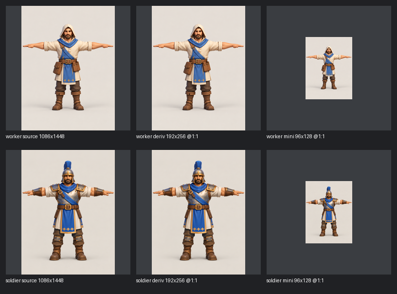

# AT5 / #105 — 2D Asset Pipeline: verification report

Epic [#100](https://github.com/Web-Usov/web-rts/issues/100), Issue [#105](https://github.com/Web-Usov/web-rts/issues/105), Art [#80](https://github.com/Web-Usov/web-rts/issues/80), Spec [#003](../../specs/003-agent-tooling-and-verification.md).

## Что реализовано

Один offline-инструмент поверх существующего skill `create-game-assets`: [`prepare_reference.py`](../../../.agents/skills/create-game-assets/scripts/prepare_reference.py) (Pillow, без новых зависимостей, без сети).

```
Registered reference → SHA-256 + limits → deterministic resize → QA → atomic write → manifest entry → contact sheet → manual visual review
```

| Команда | Назначение |
| --- | --- |
| `inspect` | dimensions, format, mode, alpha, bytes, SHA-256 |
| `derive` | resize одного зарегистрированного референса, QA, запись в существующий manifest |
| `verify [--reproduce]` | hashes, parent link, права parent (license/restrictions копируются как есть); `--reproduce` пересобирает derivative и сравнивает пиксели (байты — `--strict-bytes`) |
| `sheet` | before/after contact sheet |
| `generate` | fail-closed gate, см. ниже |

Переиспользовано: `asset_report.py`, `build_preview_sheet.py` (не изменены), `asset-manifest.json` `schema_version: 1`, `scripts/validate_assets.py` (расширен — старые проверки сохранены), существующий CI job `asset-validation` (добавлен один шаг с unit-тестами, нового workflow нет).

Поведение: exit 0 PASS / 1 FAIL / 2 ERROR / 3 BLOCKED; при ошибке нет output-файла, temp-файлов и изменений manifest. Resize никогда не увеличивает и не меняет aspect ratio (режим один — `--fit inside`; `exact`/смена aspect не поддерживаются, чтобы manifest не расходился с фактом). `--overwrite` заменяет только derivative с тем же id и path (на месте, без дублей); прежний derivative сохраняется атомарным rename в backup и возвращается `os.replace` (байты не переписываются), при сбое записи manifest состояние и manifest восстанавливаются, temp/backup-файлы удаляются; если откат сам не удался, backup сохраняется и путь к нему выводится в ERROR (exit 2). Alpha: канал, целиком равный 255, удаляется без потерь; прозрачность не создаётся. **Background removal не реализован** — это отдельный шаг, требующий визуальной проверки. Пути: запрет `..`, абсолютных путей вне root, symlink на любом компоненте; оригиналы и незарегистрированные существующие файлы не перезаписываются; source читается один раз (hash и decode из одних байт). Limits: 32 MiB, 16 384 px, 100 M decoded pixels (переопределяются флагами).

Upstream [Universal Modder](https://github.com/rehan-remade/universal-modder) (MIT) изучен (`skills/fal-assets`, `um/fal.py`, `um/comfy.py`, `um/sprite.py`). Код **не копировался**; взяты только идеи: trace-запись на каждый asset и «remote off by default». Обработка — собственный Pillow-код, поэтому MIT-notice не требуется. rmbg/pixelate/PBR/texture рецепты upstream не переносились (нет проверяемой потребности в AT5).

## Реальные эксперименты (Worker, Soldier)

Источники: `worker-front.png`, `soldier-front.png` (1086×1448 RGBA, **полностью непрозрачные**, фон бежевый). Параметры: `--fit inside --method lanczos --alpha drop-if-opaque`. Оригиналы и их provenance не менялись.

| Asset ID | Output | Размер | Bytes | Source SHA-256 | Output SHA-256 |
| --- | --- | --- | --- | --- | --- |
| `core-002-worker-front-ref-192x256` | `derivatives/worker-front-192x256.png` | 192×256 RGB | 48 957 (источник 1 773 610) | `8528a778…c290bc` | `227abe34de4a061dd6874a3c1f7ab92de261968dc391167c4ee7cb9d0990ffd6` |
| `core-002-worker-front-ref-96x128` | `derivatives/worker-front-96x128.png` | 96×128 RGB | 14 076 | `8528a778…c290bc` | `d5317fd9cf3ff789e60a5d3e6a68e157288ddd7af7b2d50b716d1fbaee537189` |
| `core-002-soldier-front-ref-192x256` | `derivatives/soldier-front-192x256.png` | 192×256 RGB | 52 434 (источник 1 850 903) | `4ec5a2ba…755bde` | `1d052de60739dba80ca5324a782c6300861021e5c014603a64ae6b118237dce0` |
| `core-002-soldier-front-ref-96x128` | `derivatives/soldier-front-96x128.png` | 96×128 RGB | 15 110 | `4ec5a2ba…755bde` | `491a4ffe217df1d9e0b12d99cb62884264932b74f4c275067f77e994557e3fe4` |

Aspect ratio 1086:1448 = 3:4 точно, поэтому 192×256 и 96×128 без дрейфа. Размер уменьшился ≈ 35–36× (192×256) и ≈ 122–126× (96×128) относительно исходных PNG. Это измерение файлов на диске, не GPU/VRAM; бюджеты текстур этим PR **не вводятся** (нет measured baseline в движке). 96×128 — вспомогательный минификат для оценки strategic zoom, а не gameplay-масштаб.

Каждая запись в manifest имеет `status: experimental-derivative`, `production_approved: false`, `qa_result: PASS`, ссылку на parent id и SHA-256, pipeline, версии tool/Pillow/Python, `generation: {used: false, provider/model/seed: null, cost_usd: 0}` и `rights_status: pending` (наследуется от parent: «not recorded; rights review pending»).

### Повторяемость и время

5 последовательных запусков на каждый source (чистая копия manifest в `.artifacts/`, другой root): одинаковые байты (`227abe34…` ×5 для Worker, `1d052de6…` ×5 для Soldier) и те же хэши, что у закоммиченных файлов; `verify --reproduce` — PASS. Время `derive` (чтение, hash, decode, resize ×2 для проверки детерминизма, QA, запись) на Apple/macOS, Python 3.13.7, Pillow 12.3.0: Worker 132–140 мс, Soldier 127–129 мс (холодный первый запуск ≈290 мс). Повторяемость гарантирована при тех же версиях Pillow/zlib; версии записаны в manifest. Первый CI-прогон показал, что на Linux-zlib байты PNG могут отличаться от macOS: поэтому `verify --reproduce` требует идентичных **пикселей** и выводит WARN при расхождении только байтов; `--strict-bytes` включает строгое побайтовое сравнение (в той же среде).

## Визуальная проверка (manual, не gameplay screenshot)

- [`before-after-worker-soldier.png`](before-after-worker-soldier.png): source (downscale для показа) | derivative 192×256 @1:1 | minified 96×128 @1:1.
- [`turnaround-contact-sheet.jpg`](turnaround-contact-sheet.jpg): шесть исходных видов через существующий `build_preview_sheet.py`.



Наблюдения (мои, субъективные):

- **Силуэт и различие Worker/Soldier** читаются даже на 96×128: капюшон без выступов против шлема с высоким синим гребнем, шире плечи и наплечники у Soldier.
- **Цветовые акценты**: синий шарф/перевязь/подол остаются главным пятном у обоих; золотая окантовка и серый металл Soldier отличают его от «бежево-коричневого» Worker. Синий — иллюстративный, не утверждённый team color.
- **Края и фон**: Lanczos даёт чистые края, ореолов нет; фон бежевый и непрозрачный (cutout не делался).
- **Малый масштаб**: на 96×128 лицо, пряжки, ромбы на подоле и сумки превращаются в шум; читаются только крупные пятна. T-pose руки тонкие и длинные — для gameplay-силуэта это неинформативная поза, выводы по реальному игровому ракурсу не делаются.
- Normal/strategic zoom оценены только как reference-масштабы; в игре и Babylon scene ничего не менялось, gameplay screenshots не создавались. Player-visible изменений нет, browser playtest не требуется.

## Негативные проверки

`python scripts/test_asset_pipeline.py` (34 теста, stdlib `unittest`, CI job `asset-validation`): truncated/corrupted image; extension/format mismatch; неверный source SHA-256; source не в manifest; неполный provenance (нет license); перезапись зарегистрированного оригинала, source и чужого файла; `--overwrite` с чужим id/другим path, сбой записи manifest с откатом (и для нового, и для существующего output); `--fit exact`/`--allow-aspect-change` отвергаются; `..`, абсолютный путь вне root, symlink output dir и symlink source; limits по pixels/dimension/bytes; дубликат id; подмена derivative/parent/`production_approved` в validator; generation gate без provider/workflow/credentials. Каждый негатив проверяет код выхода, сообщение, отсутствие output/temp-файлов и неизменность manifest. Права: parent с известной license/restrictions копируется без изменений (`rights_status: inherited`), pending остаётся pending, подмена license в derivative отвергается validator. Позитивные: детерминизм ×4, overwrite на месте, no-upscale, no fake alpha, сохранение реальной прозрачности, rights inheritance, manifest validator, реальные закоммиченные derivatives.

`scripts/validate_assets.py`: добавлена проверка каждого tracked `asset-manifest.json` (SHA-256/bytes существующих файлов, parent link, inheritance, `production_approved: false`); `--self-test` расширен; все 163 ранее tracked растра проходят как раньше.

## Generation Gate: BLOCKED

Проверено на машине агента: локальный ComfyUI на `localhost:8188` не отвечает, `FAL_KEY` не задан, workflow и модели не предоставлены, разрешение на платные вызовы/загрузку референсов вовне не получено. Платные API и скачивание моделей не запускались, расходов нет (`cost_usd` не записывается как факт генерации). `generate` — fail-closed preflight: по умолчанию выключен, без provider/workflow/credentials/явных `--allow-upload --allow-paid` возвращает BLOCKED (exit 3), а transport не реализован, поэтому даже при наличии ресурсов он не симулирует результат. Секреты не печатаются и не пишутся. Resize не называется AI-generated.

## Решения

1. **Local deterministic processing + QA — Adopt.** Доказано на двух реальных референсах, повторяемость байтов, негативы, совместимость с v1.
2. **Optional generation adapter — Iterate / BLOCKED.** Реальный pilot невозможен без ресурсов; выбор ComfyUI vs fal отложен до выделения GPU/ключа и разрешения пользователя. Нужны: работающий ComfyUI + workflow + модель (или бюджет и разрешение на upload), затем transport и запись actual model/seed/cost.
3. **Готовность интерфейса к AT6 — Iterate (условно готов).** Manifest/provenance/hash/limits/QA-интерфейс пригоден как основа, но GLB-валидатор, зрелый Mesh Studio API (#85/#86) и rights review остаются предпосылками AT6. Derivatives нельзя продвигать до production-approved.

## Ограничения

- Только resize; нет background removal, PBR/texture, atlas packing.
- Визуальная оценка субъективна; independent review обязателен.
- Rights Worker/Soldier — pending, наследуется.
- Байтовая повторяемость PNG гарантирована только в той же среде (Pillow/zlib); между машинами проверяется идентичность пикселей.
- Machine artifacts (`.artifacts/verification/at5/`, git-ignored): `asset-report.txt`, логи проверок.

## Project Status Check

**Required** — выполнено: `docs/project-status.md` содержит устойчивый AT5 checkpoint со ссылкой на этот отчёт (без SHA/CI).
