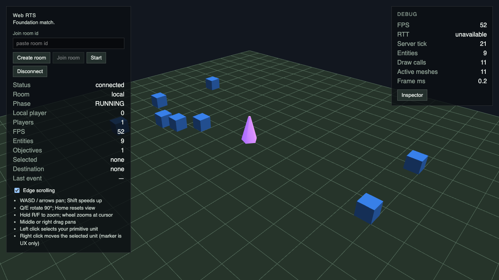
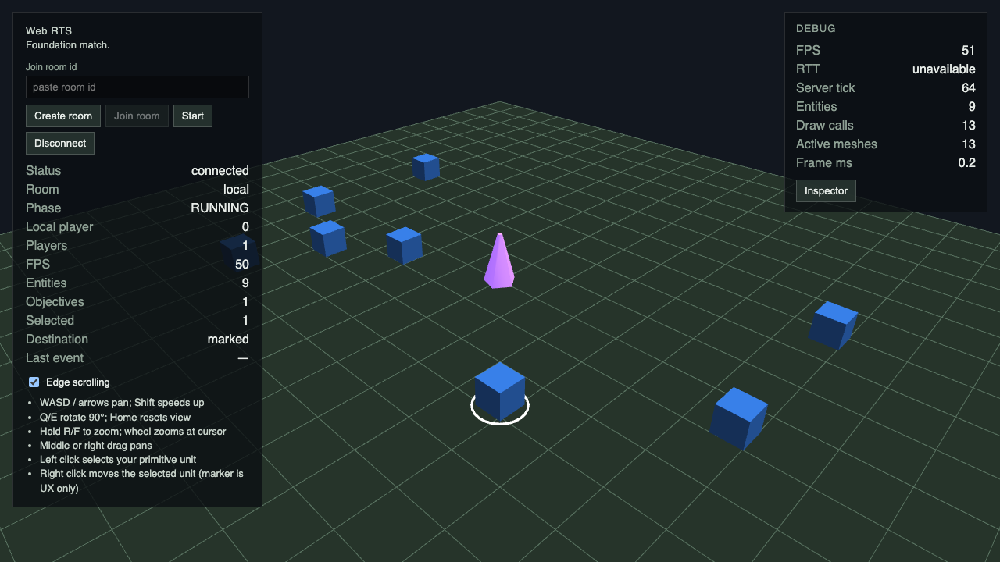
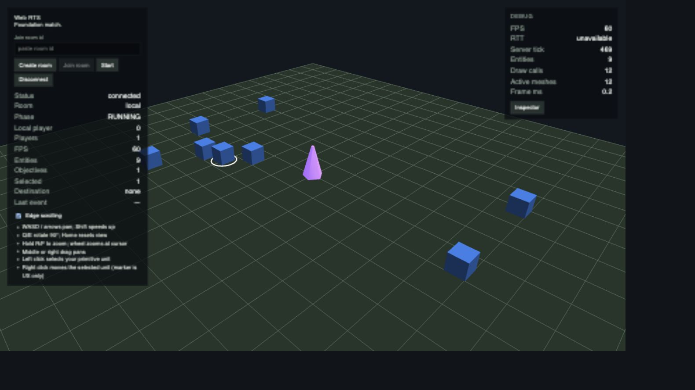
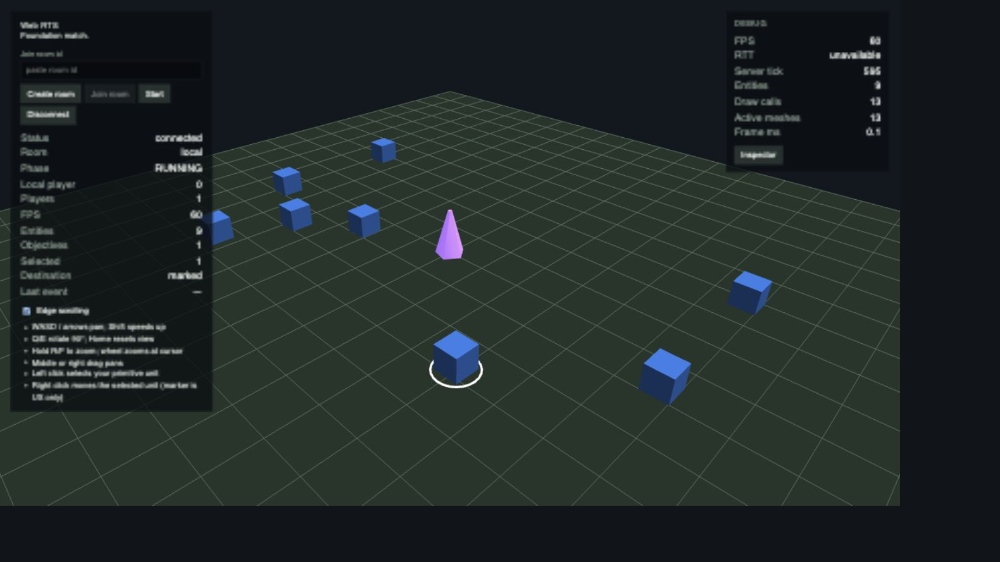
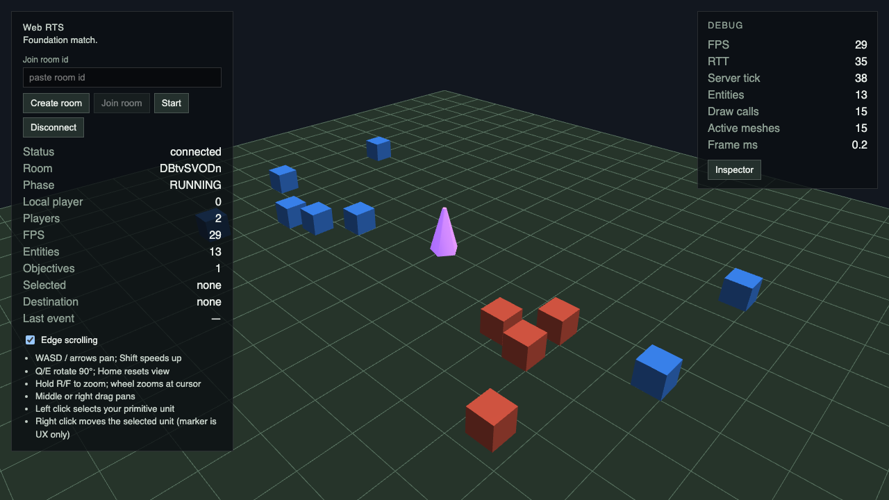
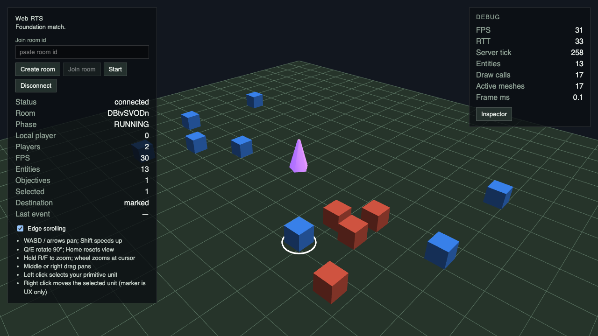
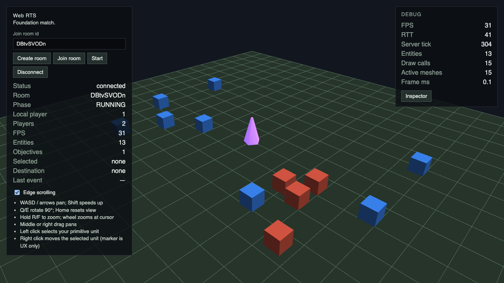
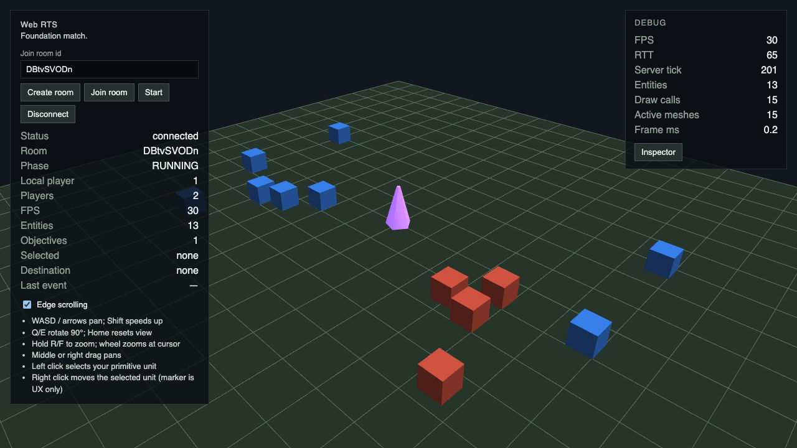
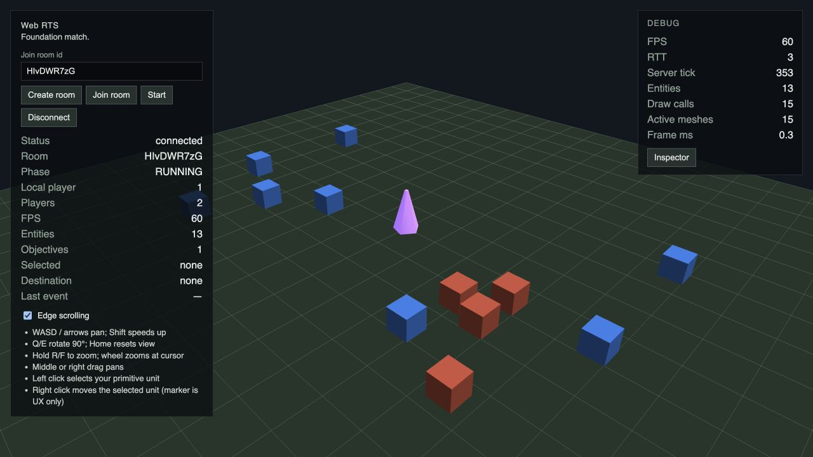

# AT7 / #107 — Browser Gameplay Replay & Verification

[Issue #107](https://github.com/Web-Usov/web-rts/issues/107) · [Spec #003](../../specs/003-agent-tooling-and-verification.md). Эксперимент 14 октября 2026, base `b550c71091c91608739ebc654f98415eef3447d5`; Node 25.9.0, pnpm 10.8.1, Playwright 1.63.0, Chromium из установленного Playwright. Production simulation, protocol, transport, renderer и UI не изменены.

## Интерфейс и воспроизведение

Небольшой typed harness в `tests/e2e/browser-replay.spec.ts` использует существующие canvas/HUD helpers. Выбор сценария/режима — штатный Playwright filter, единственный сценарий сейчас MOVE. Нового DSL, runtime package, сервера или browser bridge нет.

```sh
pnpm install --frozen-lockfile
pnpm build
pnpm exec playwright install chromium
pnpm verify:browser --retries=0
pnpm verify:browser --grep 'MOVE local' --retries=0
pnpm verify:browser --grep 'MOVE remote' --retries=0
# Три независимые команды; разные browser contexts и rooms каждого запуска.
AT7_EVIDENCE_DIR=.artifacts/verification/at7/repeat1 pnpm verify:browser --retries=0
AT7_EVIDENCE_DIR=.artifacts/verification/at7/repeat2 pnpm verify:browser --retries=0
AT7_EVIDENCE_DIR=.artifacts/verification/at7/repeat3 pnpm verify:browser --retries=0
# Ожидается Playwright exit 1 и report FAIL, не ERROR.
AT7_WRONG_EXPECTATION=1 AT7_EVIDENCE_DIR=.artifacts/verification/at7/wrong-expectation pnpm verify:browser --grep 'MOVE local' --retries=0
pnpm exec playwright test tests/e2e/camera-controls.spec.ts --retries=0
pnpm test:e2e --retries=0
```

Existing Playwright config поднимает web 4173 и server 2568. Не запускать одновременно другой browser suite, server integration, install/build, source edits или процессы с другой версией на этих портах. `reuseExistingServer` не менялся; нужно удостовериться, что порт обслуживает task worktree. В экспериментах серверы поднимались конфигурацией из этого worktree.

Local: UI Create room → настоящий WebWorker → Start; RUNNING/players=1/objectives=1; pixels Sacred Site; left selection своего Foundation proxy → RMB по земле → destination feedback → displacement ≥8 CSS px; objective остаётся в пределах существующего 8 px допуска. Нет game-server WebSocket. Remote: две отдельные BrowserContext, A создаёт room/B joins, A Start, оба RUNNING/players=2/objectives=1; public MOVE A становится видимым у B через server replication. Проверяются HUD Last event, console/pageerror/crash и screenshots обеих страниц.

Перед MOVE B кликает в видимый proxy A. Та же **точная координата** сначала успешно выбирает тот же юнит у A: `foreign-hit-proof`. У B Selected=none, после RMB Destination=none. Три наблюдения с шагом минимум три **видимых** server ticks подтверждают drift <2 CSS px на A и B. Затем MOVE A проходит: UI остаётся работоспособным. Это настоящий **UI-level unauthorized negative**. Он доказывает отсутствие foreign control через UI и наблюдаемого движения в проверенном окне; server-side COMMAND_REJECTED здесь не заявляется, поскольку UI не отправляет foreign command. Raw malformed/server rejection остаются в protocol/runtime/server integration tests.

## Versioned evidence contract




Каждый test имеет собственный каталог `<testId>-repeat-N-retry-N` внутри `.artifacts/verification/at7/`; его `evidence.json` и recordings сохраняются между запусками. Для разных независимых команд использовать разные AT7_EVIDENCE_DIR: одинаковый testId/repeat/retry иначе перезаписывает собственный предыдущий report.

`schemaVersion:1`:
- `scenarioId/mode`: move, local/remote;
- `reference`: реальный AT3 `move.json`, SHA-256 исходного fixture, seed/ticks/setup/ordered MOVE и checks;
- `setup`: entry URL, viewport, видимое количество участников и недоступные UI controls;
- `actions`: actor и реально выполненные публичные UI действия/ canvas coordinates, без shell room/session IDs;
- `observations`: нормализованные HUD strings, screenshot CSS centroids/displacements, negative drifts; это presentation observations, не simulation DTO;
- `checks`: id, expected/actual, PASS/FAIL/reason; обязательный набор зависит от режима;
- `parity`: явные supported semantic, unsupported exact и дополнительные browser regressions;
- `errors`: console errors/pageerror/crash и ошибки harness;
- `artifacts`: относительные пути к PNG, двум отдельным Remote traces и videos;
- `run`: wall-clock duration/start, browser/project environment, retry/repeat и observed ticks отдельно от comparison checks;
- `status`: PASS, FAIL или ERROR. Playwright exit 0 только при PASS; несовпадение/error → exit 1.

Пустые/неполные/duplicate checks, missing/null/non-finite observations, поддельный check.status, runtime errors и незавершённый сценарий не дают PASS. ASSERT mismatch даёт FAIL; недоступное наблюдение, missing artifact и budget error — ERROR. Limits: JSON 64 KiB UTF-8, checks 64, UI actions 32, observations 64, run samples 32, console/page errors 32×1024 chars (overflow явный ERROR), artifacts ≤16 и ≤128 MiB на режим. Бюджет artifacts выбран после pilot: Local около 24 MiB, Remote около 90 MiB, основная стоимость — trace resources/screenshots. Превышение не превращается в PASS. Большой JSON заменяется компактным ERROR report. Harness errors ограничены 2048 chars; screenshots имеют 5 s diagnostic timeout, основной oracle использует bounded polling, без arbitrary sleeps.

Contract tests упражняют empty/missing/duplicate/non-finite checks, fake status, console failure и лимиты JSON/files/bytes. Диагностические screenshots/trace/video сохраняются и для успешных runs; GitHub Actions загружает AT7 в **существующий** playwright-e2e-artifacts на 14 дней. Новых CI jobs/gates нет. Root lint/typecheck дополнительно проверяют новые browser harness files.

## AT3: поддерживаемое сравнение

AT3 MOVE: seed=98, один participant 0, Foundation unit, command MOVE (4,-3) на tick 0, 120 steps. UI использует `seed:1/mapId:foundation` в App; ConnectOptions поддерживает seed, но публичная форма/URL seed не задают. Цель RMB определяется ground picking; мировой target, command admission tick, fixed step schedule и полный recipient projection через текущий UI недоступны. Remote bootstrap содержит двух participants.

**Exact parity unsupported**: одинаковая реализация MatchRuntime не делает seed/setup/commands/checkpoints одинаковыми. Нельзя сравнивать screenshot displacement с final `x=4,y=-3` или выдавать HUD tick за causal command tick. Не добавлены production hooks для scheduler/World/hidden state и не импортируется transport singleton для обхода UI.

**Semantic/observable parity supported**: owned MOVE приводит к видимому displacement и допустимому управлению тем же proxy. Browser дополнительно проверяет неизменность objective и UI запрет foreign control; AT3 MOVE fixture **не содержит** objective assertion, поэтому это не выдается за matched AT3 check. Last event='—' — ограниченное recipient-visible UI evidence, не полная история simulation events. Exact position/tick и server-side rejection остаются сильнее проверены headless/integration слоями.

Три независимых compiled AT3 MOVE CLI процесса дали PASS/exit0, по 5172 bytes, одинаковый SHA-256 `53d942d10a3322280053e4dc9cc3e2be2596bc8d102e29d43c36f5c646574451`. Median 235,7 ms, range 165,2–305,9 ms (Node startup+simulation+JSON; warm build, без pnpm/build startup). Combat и permanent-leave PASS, hashes совпадают с AT3 report; `--list` и AT4 catalog `--list` работают. Existing legacy AT1/AT3/AT4 tests сохранены.

## Повторы и чувствительность oracle

| Запуск | Mode | Status | Checks | Seconds | JSON bytes | Artifacts MiB |
| --- | --- | --- | ---: | ---: | ---: | ---: |
| repeat1 | local | PASS | 11 | 9.587 | 7188 | 24.18 |
| repeat1 | remote | PASS | 18 | 41.598 | 10687 | 90.36 |
| repeat2 | local | PASS | 11 | 10.027 | 7189 | 24.39 |
| repeat2 | remote | PASS | 18 | 40.864 | 10688 | 89.87 |
| repeat3 | local | PASS | 11 | 9.920 | 7218 | 24.57 |
| repeat3 | remote | PASS | 18 | 40.965 | 10718 | 89.53 |

Повторы запускались отдельными pnpm commands, без retries. Caps tests добавлены перед третьим run, browser actions/oracle/hit-proof одинаковые во всех трёх. Ни одного console/pageerror. Negative drift на обеих страницах во всех трёх samples каждого Remote run равен 0. Objective сохранён.

Local observed MOVE displacement: 100,48 / 111,96 / 108,56 CSS px; Remote A: 241,21 / 200,89 / 195,28, B: 260,46 во всех трёх. Разница — screenshot/interpolation/wall-clock timing: останавливаемся при доказанном displacement, а не на одном fixed tick/final arrival. Browser reports **не** byte-identical и не обещают exact replay; одинаковы statuses и семантические checks. Timestamp/ticks/duration находятся в run metadata. Polling завершается по наблюдаемым условиям, test timeout остаётся существующим 120 s; retries/timeouts/pixel thresholds конфигурации не увеличивались.

Controlled browser expectation `FINISHED` вместо реально видимого `RUNNING` после настоящего MOVE: report **FAIL**, exit **1**, остальные checks PASS и errors=[]. Это sensitivity browser oracle, не имитация runtime rejection или изменение gameplay.

Диагностика относительно existing smoke: те же public UI/pixel observations, но теперь reviewer получает действия, строгие checks, ограничения parity и отдельный JSON даже для неверного expectation, recordings обоих contexts и негативное доказательство. Existing smoke сам по себе не предоставляет этот общий report. Browser workload существенно дороже warm AT3 CLI; это разные уровни проверки, не benchmark simulation и не доказанная экономия Coding Agent time/tokens.

Подготовительные runs: первый harness вызвал повторный tracing.start поверх automatic Playwright trace и упал (ошибка setup, не gameplay). После исправления один запуск на фоне repository checks получил Vite reconnect/повторный Babylon init во время screenshot и затем test timeout; root cause изменения Vite runtime **не установлен окончательно**. Запуск был остановлен, Remote не выполнялся; он не засчитан как PASS. Исходные log и before screenshot сохранены locally, полный transient trace был перезаписан следующим Playwright run — это ограничение диагностики pilot. Финальный harness хранит recordings вместе с JSON, ограничивает diagnostic screenshot timeout и обрабатывает context-close errors; последовательные runs без фоновых checks проходят. Camera centroid failure в AT7 не наблюдался. Нельзя скрывать этот setup failure или считать его доказанным camera defect.

## Camera regression и внутренний browser playtest

Причина старого AT1 centroid flake уже установлена C2 / #112 / merged [PR #113](https://github.com/Web-Usov/web-rts/pull/113): цветовой фильтр destination захватывал selection ring и изменял centroid при перекрытии. Используется актуальный `camera-reference.ts`: неподвижный ground cross, independent ray, 2 CSS px anchor tolerance и физический pan negative. Расследование/production camera math не повторялись и не менялись. Текущие Local/Remote physical controls и repeated wheel regressions прошли в полном E2E suite без retries: ground anchor maximum drift 0,5 px во всех четырёх yaw обоих режимов, physical pan negative 64,195 px. Полный suite: 16/16, 6,8 min. В нём existing F11 smoke занял 7,3 s, F7 двухклиентный smoke 23,3 s; новый harness 9,1/39,5 s. New Remote workload добавляет foreign negative, recordings/JSON и больше observations; это не одинаковые workloads.

В existing Inspector smoke после его assertClean появился vendor console.error `Keyborg instance k1 is being disposed incorrectly`. Этот test не менялся; событие вне новых AT7 MOVE contexts. Оно не скрывается как «весь suite без console errors»: строгие AT7 reports и внутренний playtest имеют errors=[].

Инструмент реального внутреннего playtest: **Codex In-app Browser / cua_repl**, web 4173/server2568 из task worktree. Local Create → Start → selection → RMB MOVE; Remote две отдельные tabs/sessions (HUD players0/1, players=2), A Create/B Join → Start, successful select A → foreign select/RMB B (Selected/Destination none, unit неподвижен) → valid MOVE A, перемещение видно у B, objective=1. Console warn/error lists пусты. World/MatchRuntime/hidden data не читались; UI и canvas не подменялись.










## Проверки и решение

Локальные commands: `pnpm lint`, `pnpm typecheck`, `pnpm test`, `pnpm test:simulation`, `pnpm build`, `pnpm test:server`, `pnpm verify:browser --retries=0` (три независимых пары), controlled wrong-expectation (ожидаемый exit1), полный `pnpm test:e2e --retries=0`. Фактические final suite totals и GitHub Actions exact-head links фиксируются в PR; локальные runs не заменяют required CI.

**Adopt** для ограниченной browser semantic verification MOVE: positive/negative воспроизводимы, wrong assertion действительно FAIL, diagnostics и границы сравнения явны. Exact replay остаётся unsupported; BUILD/combat public UI и AT8/AT9 не реализованы. Новый ADR не нужен: accepted boundaries не менялись.

Architectural impact: **none**. Project Status Check: **Required — выполнен**: AT7 checkpoint со ссылкой на этот report обновлён; transient main SHA, PR/CI status в checkpoint не добавлены.
