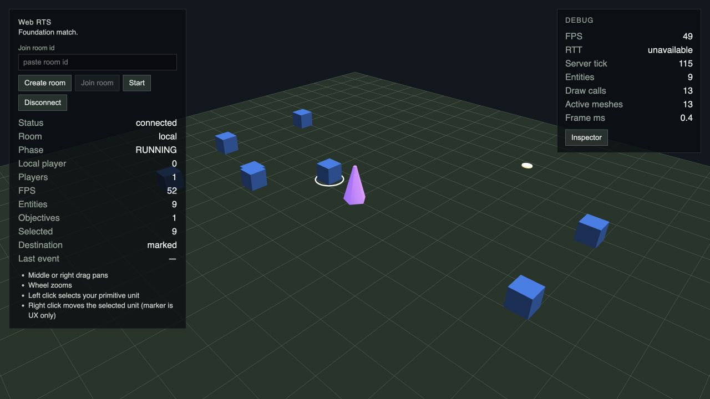

# G6 / #59 — Combat / Teams / Soldier, интеграция с G5

## Gameplay contract

- TeamId — отдельный stable id. Player assignment и symmetric relationship policy принадлежат World/match. Разные owners одной Team friendly; no-Team и неперечисленные пары Team neutral. Player Team ↔ PvE Team hostile.
- Stats Worker/Town Hall/Soldier/Sacred Site находятся в game-data. Combat требует hostile + allowed kind + living Health; melee range считается до края зарегистрированного footprint, с проверкой intervening blockers.
- Tick t — `World.tick` перед increment. Первый eligible strike применяется сразу, следующий при `t >= lastStrikeTick + cooldownTicks`. Cooldown не сбрасывается при смене цели/MOVE. Entity pass/attacks — ascending entityId; killed entity не отвечает в том же tick.
- Soldier хранит acquisition anchor на весь chase. После выхода из envelope цель исключена до выхода из текущего aggro radius, чтобы немедленная reacquisition не расширяла chase. Unreachable target повторно проверяется после смены его cell/topology; следующий кандидат участвует в последующем tick. Failed A* не повторяется каждый tick.
- MOVE отменяет combat только после atomic acceptance и подавляет auto-engagement до arrival/termination. После потери цели Soldier остаётся IDLE на текущей позиции.
- Combat approach использует существующий multi-goal A*, smoothing и continuous movement primitive. Один ascending-entityId pass объединяет economy hooks → movement → combat; одна active-task lane обслуживает GATHER transitions/replans, Soldier approach и MOVE replans в ascending entityId, максимум одна expensive query/entity/tick. Stale/deferred paths не пересекают blockers.
- Death удаляет economy/combat компоненты, navigation/footprint, активные target references и unreachable memo. Worker death прекращает GATHER без phantom deposit; Town Hall death вызывает ACTION_FAILED(no_dropoff), сохраняет carried Wood и не завершает match. Objective record сохраняется; result/DEFEAT lifecycle — G10. Public combat replication/UI — G11/G12.

## Static contract

`GAME_DATA_VERSION = 0.3.0`: Soldier definition/spawn, Worker HP 60, Town Hall HP 500. Soldier HP 100 и Sacred Site HP 1000 задаются в game-data. `PROTOCOL_VERSION = 4` сохранён; Local и Remote отвергают старые game-data 0.1.0/0.2.0. Wood не имеет Team/Health. Общий MatchRuntime bootstrap: Foundation proxy, Worker, Town Hall, четыре Wood nodes, Soldier на participant и shared Sacred Site. Internal snapshots содержат economy/combat defensive copies; public projection не расширена.

## Automated verification

Unit/regression tests: Team/eligibility/friendly fire, first-strike/cooldown boundaries при разных tickHz, death/Objective, nearest-target/tie-break/stickiness, bounded chase, unreachable retries, MOVE override/rejection/termination, 2×2 approach, shared path lane и deferred replan, bootstrap/control release, snapshot copying и отсутствие internal combat fields в public projection.

Regression review fix: повторные spawn/death циклы недостижимых целей очищают `unreachable` у обоих Soldier сразу при death, сохраняя memo живых целей.

Scenario runner использует существующий `runScenario` с declarative map: одинаковые seed/commands/ticks дают одинаковые positions, Health, combat/task state, events и lethal outcome. Existing movement/objective/reconnect/parity tests сохраняются.

Локально green: frozen install, typecheck, lint, test (214 simulation unit tests), test:simulation (6 scenarios), test:server (42 integration tests) и build; `pnpm test:e2e` — все 8 E2E green.

Совместные regression tests покрывают GATHER+combat, scarce budget в обоих вариантах entityId order, friendly Worker/Town Hall и neutral Wood, damage обоим destructible типам, Worker death без deposit, Town Hall death с сохранением carry/failure, rejected MOVE/GATHER atomicity и accepted group MOVE, defensive snapshots и повторение combined state/events через существующий runScenario.

## Визуальная проверка

Внутренний инструмент: `cua_repl` / Codex In-app Browser, viewport 1280×720. Web/server подняты из task worktree на 5189/2579.

Проверено фактически:

1. Local `Create room → Start → RUNNING`: 9 entities, 1 objective: Foundation, Worker, Town Hall, четыре Wood nodes, Soldier и Sacred Site. Worker выбран как Selected = 3, Soldier — Selected = 9. Ground MOVE Worker и Soldier запущены одновременно, оба перемещения завершены.
2. Local MOVE Soldier к ground point внутри solid footprint Sacred Site: Soldier останавливается на доступной границе; Objective сохраняется, COMMAND_REJECTED не возникает.
3. Remote: два независимых tab, create/join одного room, START → RUNNING у обоих; 13 entities, 1 objective. Soldier первого player выбран (Selected = 12) и перемещён; оба клиента показывают одинаковую конечную позицию.
4. Remote reload/reconnect первого клиента: прежний PlayerId 0, RUNNING, 2 participants, 13 entities и Soldier position восстановлены.
5. `tab.dev.logs(levels=[error])` — пусто для Local и обоих Remote gameplay flows. Наблюдение attack/Health UI не заявляется: combat projection и PvE spawn/AI остаются G11/G9.

Playwright сохраняет Foundation Local/Remote/reconnect/regression checks и проверяет G5+G6 Soldier Local/Remote flows, включая Worker MOVE. Helper отслеживает connected blue pixel regions по независимым Foundation/Worker/Soldier tracks, исключает прочие известные proxy и сохраняет track через reconnect. Использован стандартный `pnpm test:e2e` на 4173/2568; production/test configuration не изменена.
