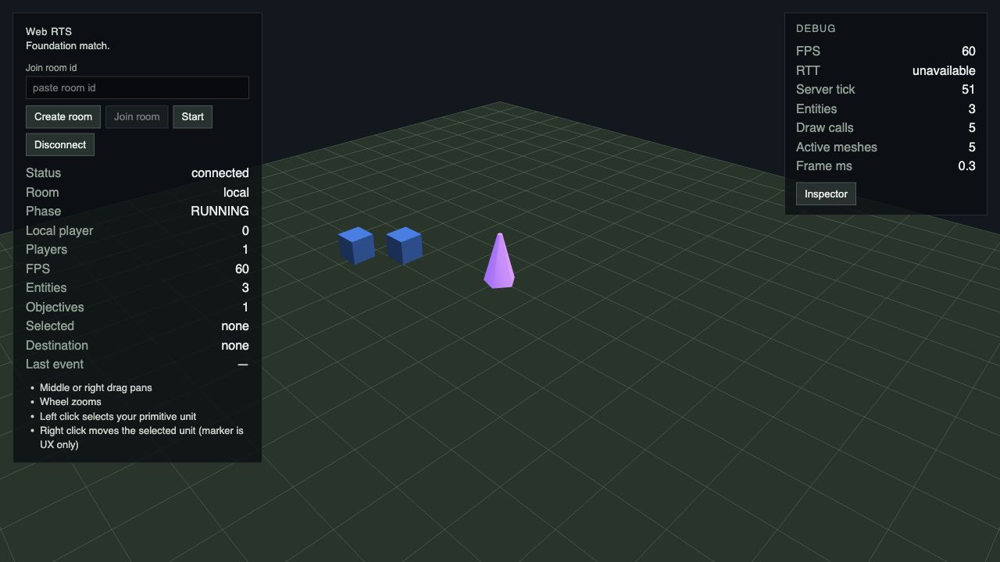
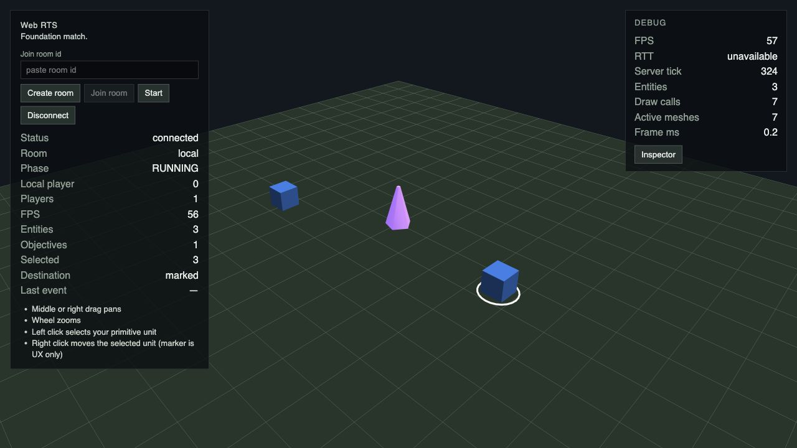
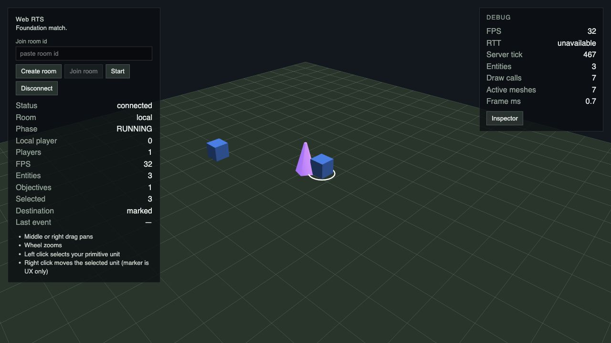
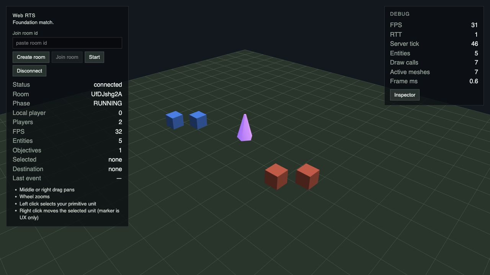
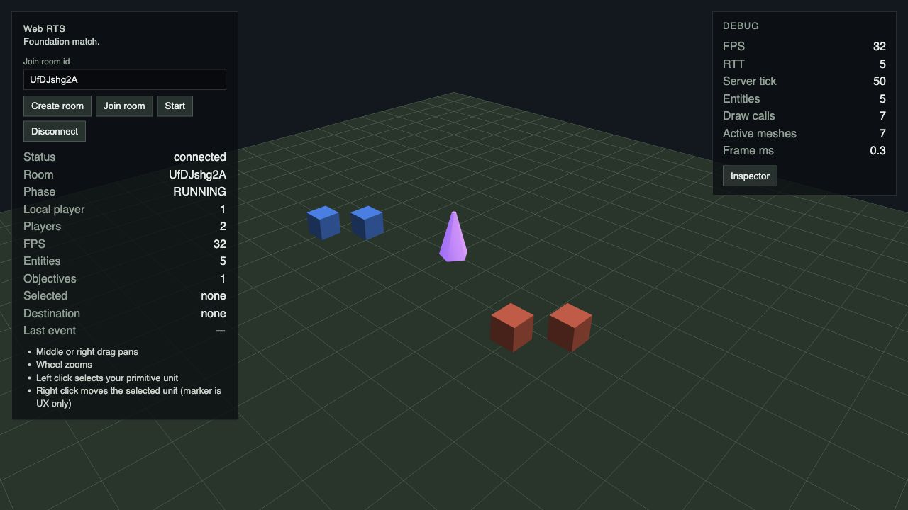
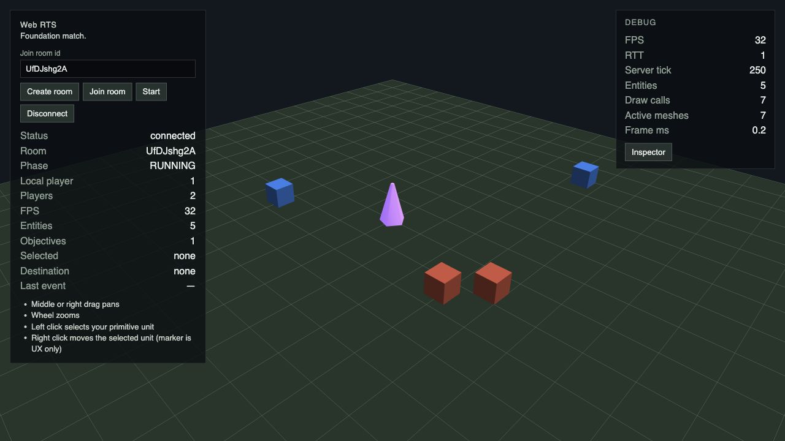
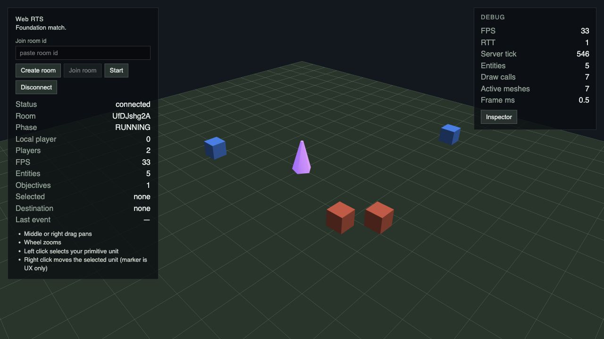

# G6 / #59 — Combat / Teams / Soldier

## Gameplay contract

- TeamId — отдельный stable id. Player assignment и symmetric relationship policy принадлежат World/match. Разные owners одной Team friendly; no-Team и неперечисленные пары Team neutral. Player Team ↔ PvE Team hostile.
- Stats Soldier/Sacred Site находятся в game-data. Combat требует hostile + allowed kind + living Health; melee range считается до края зарегистрированного footprint, с проверкой intervening blockers.
- Tick t — `World.tick` перед increment. Первый eligible strike применяется сразу, следующий при `t >= lastStrikeTick + cooldownTicks`. Cooldown не сбрасывается при смене цели/MOVE. Entity pass/attacks — ascending entityId; killed entity не отвечает в том же tick.
- Soldier хранит acquisition anchor на весь chase. После выхода из envelope цель исключена до выхода из текущего aggro radius, чтобы немедленная reacquisition не расширяла chase. Unreachable target повторно проверяется после смены его cell/topology; следующий кандидат участвует в последующем tick. Failed A* не повторяется каждый tick.
- MOVE отменяет combat только после atomic acceptance и подавляет auto-engagement до arrival/termination. После потери цели Soldier остаётся IDLE на текущей позиции.
- Combat approach использует существующий multi-goal A*, smoothing и continuous movement primitive. Одна active-task lane обслуживает Soldier approach и MOVE replans в ascending entityId, максимум одна expensive query/entity/tick. Stale/deferred paths не пересекают blockers.
- Death удаляет компоненты/footprint и активные target references. Objective record сохраняется; result/DEFEAT lifecycle — G10. Public combat replication/UI — G11/G12.

## Automated verification

Unit/regression tests: Team/eligibility/friendly fire, first-strike/cooldown boundaries при разных tickHz, death/Objective, nearest-target/tie-break/stickiness, bounded chase, unreachable retries, MOVE override/rejection/termination, 2×2 approach, shared path lane и deferred replan, bootstrap/control release, snapshot copying и отсутствие internal combat fields в public projection.

Scenario runner использует существующий `runScenario` с declarative map: одинаковые seed/commands/ticks дают одинаковые positions, Health, combat/task state, events и lethal outcome. Existing movement/objective/reconnect/parity tests сохраняются.

Локально green: frozen install, typecheck, lint, test (в том числе 181 simulation unit tests), test:simulation (5 scenarios), test:server (40 integration tests), build и 8 Playwright E2E.

## Визуальная проверка

Внутренний инструмент: `cua_repl` / Codex In-app Browser, viewport 1280×720. Web/server подняты из task worktree на 5189/2579.

Проверено фактически:

1. Local `Create room → Start → RUNNING`: 3 entities, 1 objective, два отдельных blue proxy. Soldier выбран pointer click (HUD Selected = 3), MOVE на землю выполнен и завершён.
2. Local MOVE Soldier к ground point внутри solid footprint Sacred Site: Soldier останавливается на доступной границе; Objective сохраняется, COMMAND_REJECTED не возникает.
3. Remote: два независимых tab, create/join одного room, START → RUNNING у обоих; 5 entities, 1 objective. Soldier первого player выбран (Selected = 4) и перемещён; оба клиента показывают одинаковую конечную позицию.
4. Remote reload/reconnect первого клиента: прежний PlayerId 0, RUNNING, 2 participants, 5 entities и Soldier position восстановлены.
5. `tab.dev.logs(levels=[error])` — пусто для Local и обоих Remote gameplay flows. Наблюдение attack/Health UI не заявляется: combat projection и PvE spawn/AI остаются G11/G9.

Playwright сохраняет Foundation Local/Remote/reconnect/regression checks и добавляет отдельные G6 Soldier Local/Remote flows. Для локального запуска использован временный config с портами 4189/2589: стандартный 4173 занят параллельным G5 worktree. Production/test configuration проекта не изменена.
