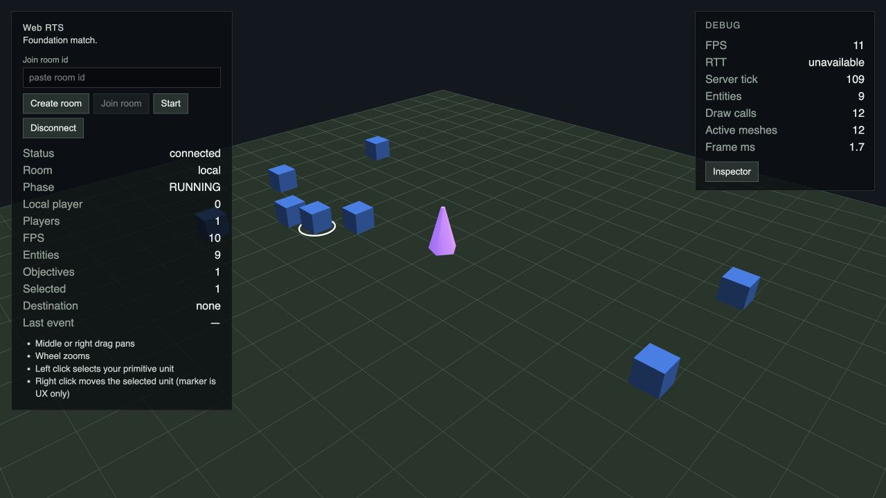
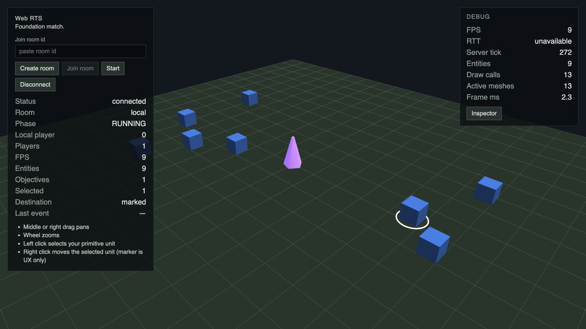
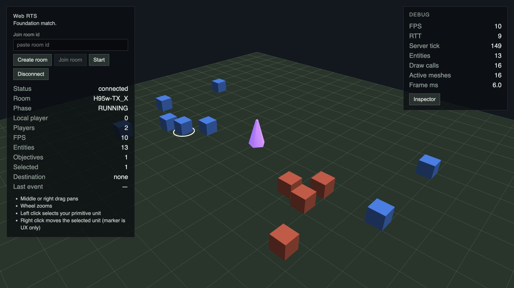
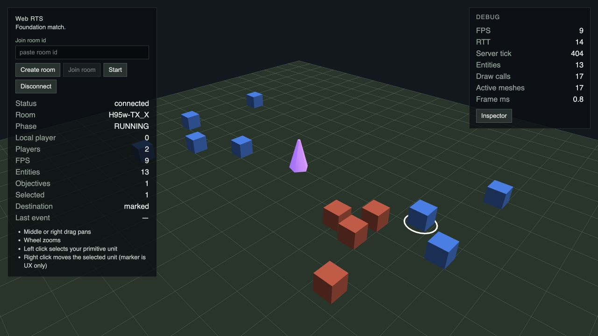
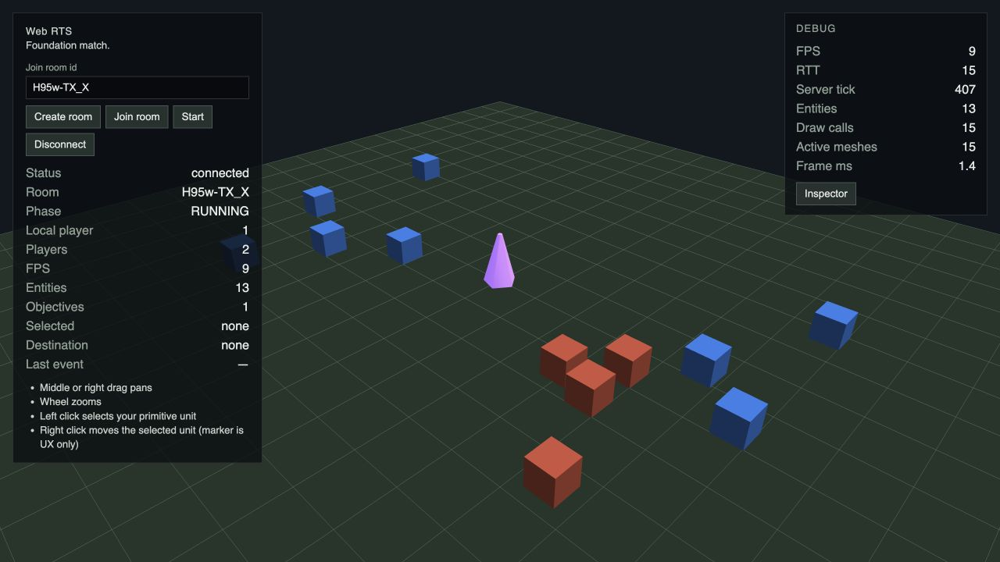
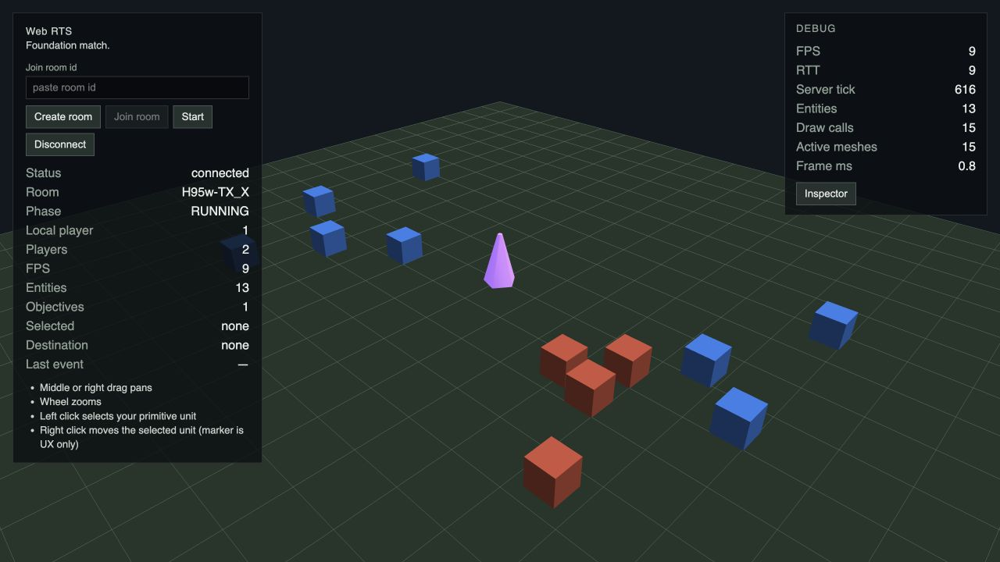
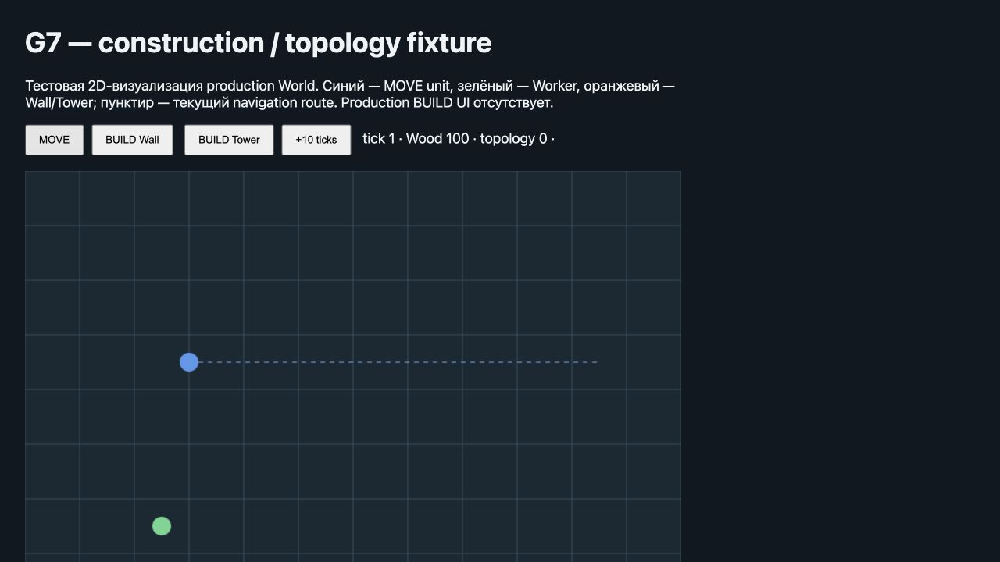
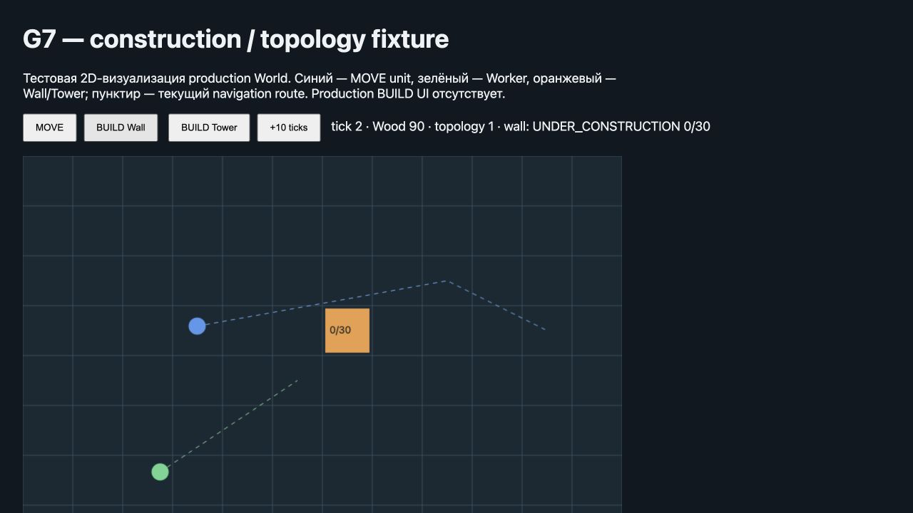
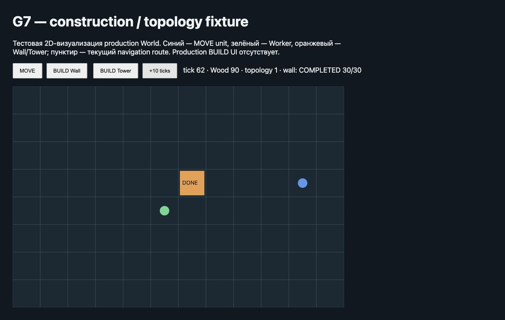
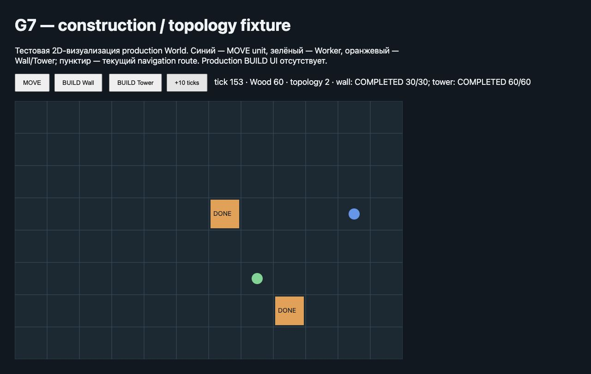

# G7 / #60 — verification

## Внутренний browser smoke

Инструмент: `mcp__cua_repl`, Codex In-app Browser. Проверка выполнена 2026-10-12
в task worktree. Vite: `4175`, Remote server: `2569`, viewport: `1280×720`.

- Local: Create room → Start → RUNNING, 9 entities и 1 objective; left click
  выбирает entity 1, right click отправляет MOVE; видны selection ring,
  destination marker и новое положение unit.
- Remote: Create room → Join во втором browser tab → Start; два игрока,
  13 entities и 1 objective. MOVE первого игрока виден в обоих клиентах.
- Reload второго Remote client: reconnect возвращает player 1, RUNNING,
  те же 13 entities и два игрока; перемещённый unit сохраняет положение.
- Console `error`/`warn` для трёх протестированных tabs: пустые списки.

## Изолированный construction fixture

`tests/e2e/fixtures/g7-construction.html` импортирует production
`@web-rts/simulation` и game-data из task worktree. Fixture не импортируется
production приложением. Это тестовая 2D-визуализация World, а не Babylon renderer.
Открытие через Vite: `/@fs/<absolute-worktree>/tests/e2e/fixtures/g7-construction.html`.

Реальные browser clicks:

1. MOVE: tick 1, Wood 100, topology 0, прямой navigation route.
2. BUILD Wall: tick 2, Wood 90, topology 1, UNDER_CONSTRUCTION 0/30;
   MOVE route немедленно перестраивается вокруг нового footprint.
3. Шесть нажатий `+10 ticks`: tick 62, Wall COMPLETED 30/30;
   MOVE unit дошёл до destination, topology остаётся 1.
4. BUILD Tower и девять нажатий `+10 ticks`: tick 153, Wood 60,
   topology 2; Wall COMPLETED 30/30, Tower COMPLETED 60/60.
5. Console `error`/`warn` fixture: пустой список.

## Ограничение

Полноценный Local/Remote BUILD flow в production Babylon UI недоступен:
public BUILD command, Construction wire projection и interaction UI принадлежат
G11/G12. Fixture доказывает реальную simulation topology и completion в браузере,
но не заменяет будущую проверку production construction presentation.
