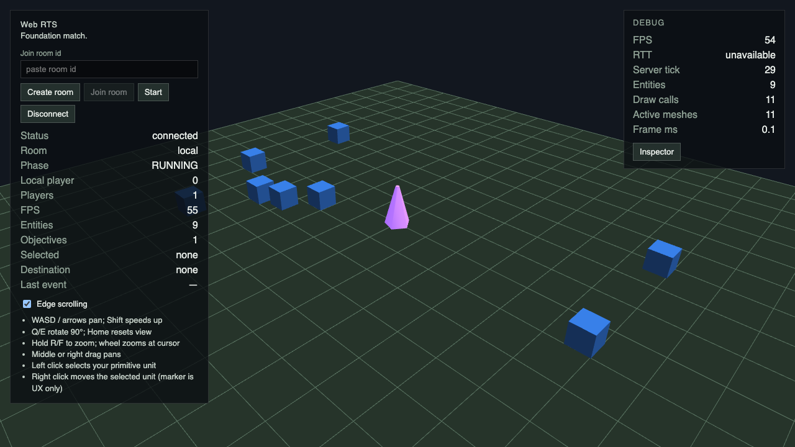
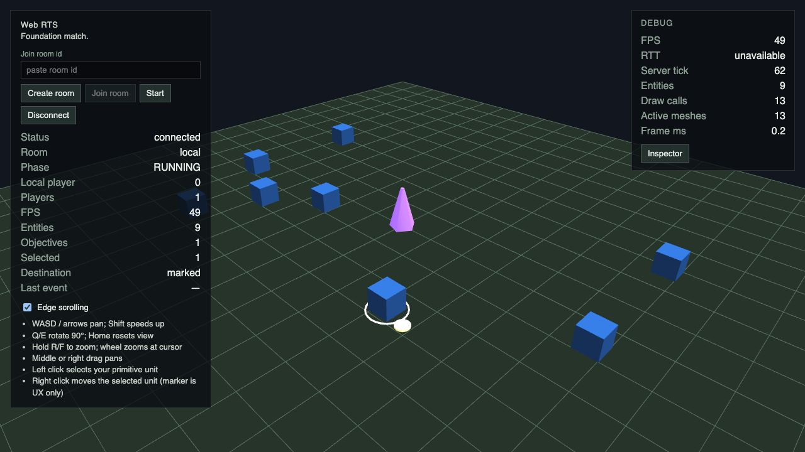
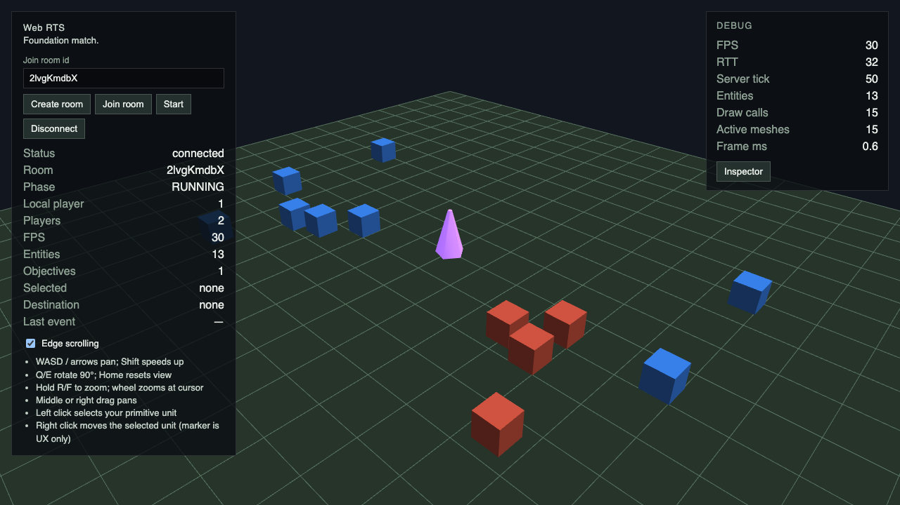
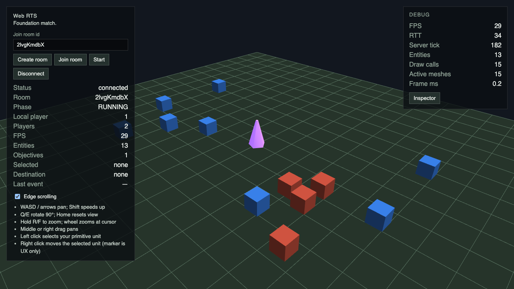

# #98 — Agent-driven Gameplay Verification

Эксперимент выполнен 13 октября 2026 на базе `6de22bff7af7f7203142bcc449a75ddc4e217ae0` с C1 (#97), Node v25.9.0, pnpm 10.8.1; CI использует Node 22. Production gameplay, protocol, renderer и transport не меняются. Контракт: [Issue #98](https://github.com/Web-Usov/web-rts/issues/98), [Spec #002 §25–27](../../specs/002-first-economy-defense-vertical-slice.md), ADR-004/009.

## Интерфейс и повторный запуск

```sh
pnpm install --frozen-lockfile
pnpm --silent verify:gameplay move > move.json
pnpm --silent verify:gameplay combat > combat.json
```

Команда сама собирает runner и зависимости через Turbo, работает без GUI/server/API/LLM. `--silent` убирает pnpm lifecycle banner из stdout: JSON идёт в stdout, краткий итог в stderr. Exit 0 = PASS, 1 = assertion mismatch, 2 = неизвестный сценарий, неверные arguments или execution error. После build можно запускать `node tools/scenario-runner/dist/cli.js move`.

`GameplayScenario` в testkit задаёт scenarioId, seed, ticks, JSON inputs и callback `execute`. Callback исполняет production gameplay и возвращает JSON observations и checks `{id,tick,expected,actual}`. `verifyGameplay` сравнивает JSON значения (порядок object keys несущественен, порядок массивов существенен), запрещает пустой набор checks и выдаёт schemaVersion 1, PASS/FAIL, причины и `firstMismatchTick`. Это первый **проверяемый checkpoint** с расхождением, не установленный момент появления дефекта. Timings измеряются отдельно.

Новый сценарий добавляется в `tools/scenario-runner/src/verification-scenarios.ts`; это trusted TypeScript fixture, не внешний scenario DSL. Ожидания задаются независимо от execution, игровые правила не переписываются. MOVE использует production MatchRuntime. Combat использует существующий World builder/runScenario, поскольку MatchRuntime не имеет публичного enemy-spawn setup. Production packages не зависят от testkit.

## A — Positive verification

Выполнено пять отдельных `pnpm --silent verify:gameplay <scenario>` для каждого сценария. Полные evidence: [MOVE 1](move-1.json), [2](move-2.json), [3](move-3.json), [4](move-4.json), [5](move-5.json); [Combat 1](combat-1.json), [2](combat-2.json), [3](combat-3.json), [4](combat-4.json), [5](combat-5.json). В [runs.json](runs.json) находятся exit codes, wall durations и SHA-256 каждого stdout.

- MOVE: seed 98, foundation bootstrap, player 0, entity 1, MOVE на tick 0 к (4,-3), 120 ticks. Проверяется admission, точное прибытие к target, отсутствие rejection events, количество выполненных ticks.
- Combat: seed 59, map без terrain/startingPlacements, Soldier/player team в (-8.5,-8.5), enemy/PvE team с 40 HP в (-4.5,-8.5), MOVE на tick 1 к (-6.5,-8.5), 130 ticks. Проверяется смерть enemy, выживание Soldier, возврат Soldier в IDLE и отсутствие command rejection.

10/10 запусков PASS (exit 0); внутри каждой группы JSON побайтно одинаков. Это дополняет конкретные assertions; сравнение повторов само по себе не является oracle. Существующие combat regression fixtures/tests сохранены.

## B — Negative verification

Фактические результаты и timing baseline: [negative-and-baseline.json](negative-and-baseline.json).

1. Временно заменено только `expected: { x: 4, y: -3 }` на `{ x: 999, y: -3 }` в `verification-scenarios.ts`; выполнено `pnpm --silent verify:gameplay move`. [Evidence](wrong-expectation.json), [stderr](wrong-expectation.log): FAIL, exit 1; actual (4,-3), expected (999,-3), checkpoint 120. Fixture восстановлен.
2. Временно в `packages/simulation/src/systems/combat.ts` заменено `current -= profile.damage` на `current -= 0`; выполнено `pnpm --silent verify:gameplay combat`. [Evidence](mutation.json), [stderr](mutation.log): FAIL, exit 1; enemy остаётся живым, Soldier не возвращается в IDLE. Восстановлена исходная строка; повторный CLI дал [PASS/exit 0](rollback.json). Diff simulation в итоговом PR пустой.
3. `node tools/scenario-runner/dist/cli.js missing`: [FAIL/exit 2](unknown.json). Запуск без arguments: [FAIL/exit 2](malformed.json). Неверный сценарий не превращается в PASS.

Для повторения пункта 1/2 используйте отдельный disposable worktree, измените указанную строку, выполните CLI с перенаправлением stdout/stderr, проверьте `$?`, восстановите файл через `git restore` и повторите CLI. Turbo пересобирает изменённые dependencies. Не запускайте mutation одновременно с браузерной проверкой: Vite следит за dist и перезагружает приложение при rebuild.

Vitest gate tests дополнительно проверяют испорченное observed state, неверное expectation, empty checks и malformed CLI request. Mutation реально выполнена в production combat system, а не только в тестовом mock.

## C — Реальный browser cross-check

Инструменты: Playwright Chromium и внутренний Codex browser (`cua_repl`, in-app browser). Через внутренний браузер выполнены Local create/start/select/right-click MOVE и Remote create/join/start двух вкладок, MOVE от A с наблюдением переместившегося синего юнита на B. HUD: RUNNING, 2 игрока, 13 entities, objective 1. Внутренние browser warn/error logs пусты: [logs](internal-browser-errors.json). [Screenshot клиента B после MOVE](internal-remote-b.jpg).

Playwright выполняет отдельные BrowserContexts для Remote A/B; проверяет перемещение центроида конкретного unit на canvas, изменение pixels обоих клиентов, неподвижность objective и чистые console/pageerror logs. Local проверяет WebWorker и отсутствие game-server socket. Regression paths включают диагональный MOVE, blocked target, reconnect и camera/input. MOVE headless и browser подтверждают общее движение по команде и сохранение objective; это не сравнение координат одного идентичного browser/headless replay, поскольку browser tick scheduler работает в реальном времени.

```sh
pnpm build
F7_SAVE_VERIFICATION_SHOTS=1 VERIFICATION_DIR=docs/verification/98-gameplay-harness pnpm test:e2e
```

Не запускайте server integration suite параллельно с E2E server: обе используют 2568. Если процессы подняты вручную, Vite должен получить `VITE_GAME_SERVER_URL=http://127.0.0.1:2568`; иначе reused server обслужит неправильную конфигурацию. Первый пробный запуск был прерван при исправлении конфигурации. Следующий запуск с наложением rebuild дал 8 passed / 2 failed (camera local и diagonal MOVE; последний не набрал достаточное число intermediate pixel samples): [предварительная диагностика](preliminary-e2e.log). После завершения сборок и разделения процессов чистый полный прогон дал **10 passed (5.4m), exit 0**: [e2e.log](e2e.log). Tests/assertions не менялись. Причина каждого предварительного сбоя отдельно не доказана; чистый повтор подтверждает отсутствие устойчивого regression в проверенном flow.

Local до и после MOVE:




Remote клиент B до и после команды A:




Combat/BUILD нельзя честно подтвердить публичным browser UI текущего main: gameplay command input/projection этой vertical slice ещё не завершён. Новые production endpoints для этого не добавлены.

## D — Эффективность и границы

Фактические пять измерений CLI для каждого сценария: [runs.json](runs.json). Пять baseline запусков `pnpm --filter @web-rts/scenario-runner exec vitest run src/combat.test.ts`: [results](negative-and-baseline.json), логи `vitest-1.log` … `vitest-5.log`. Это wall time процесса с pnpm/build-cache startup, не скорость simulation; Vitest запускает два существующих combat теста, поэтому сравнение не нормализовано по workload.

| Запуск (5 повторов) | Диапазон, сек | Медиана, сек |
|---|---:|---:|
| CLI move | 0.735–1.291 | 0.822 |
| CLI combat | 0.744–1.033 | 0.823 |
| Vitest combat (2 tests) | 1.969–2.653 | 2.377 |

Оба подхода требуют одну команду на запуск, пять команд на пять повторов. Новый runner уменьшает ручное извлечение inputs/state из тестов: агент сразу получает JSON expected/actual, seed, ordered commands, snapshots/events и машинный status. Vitest лучше подходит для широкого regression suite и rich matcher assertions. CLI удобнее как небольшой evidence gate и для повторяемых bug fixtures; он не заменяет regression suite, server parity/security tests, browser playtest или независимый review.

Не решает autonomous UI planning, fuzzing, live bot, performance profiling, network timing, rendering correctness и проверку ещё не реализованных механик. Нет сведений о фактическом token usage; экономия токенов не заявляется. Repeatability ограничена одинаковыми версиями runtime/data (ADR-004), cross-platform bit-perfect determinism не обещается. Прототип поддерживает exact JSON equality; tolerances и temporal assertions требуют явных будущих fixtures. Checkpoints сейчас итоговые; event trace не доказывает первый causal tick ошибки.

Рекомендация: **Iterate**. Конкретные outcomes и meaningful mutation подтверждают работоспособность gate. Применять для небольших headless evidence fixtures параллельно Vitest; следующий этап — добавить intermediate checkpoints и одну новую regression fixture из реального bug, затем shared runtime setup для combat после принятого gameplay scope. KB/RAG/боты для этого не нужны.

## Проверки и project status

Все семь обязательных команд прошли (exit 0). В simulation-tests CI дополнительно запускаются оба CLI gates.

Команды: `pnpm lint`, `pnpm typecheck`, `pnpm test`, `pnpm test:simulation`, `pnpm test:server`, `pnpm build`, `pnpm test:e2e`. Логи лежат рядом: [lint](lint.log), [typecheck](typecheck.log), [test](test.log), [simulation](simulation.log), [server](test-server.log), [build](build.log), [browser](e2e.log).

Project Status Check: **Not required** — это экспериментальный tooling prototype; roadmap, production invariants и gameplay checkpoint не изменились. Architectural impact: none. PR остаётся unmerged для независимого архитектурного и технического review.

## Источники идеи

Изучены [game-automation](https://github.com/rehan-remade/universal-modder/blob/main/skills/game-automation/SKILL.md), [verification oracles](https://github.com/rehan-remade/universal-modder/blob/main/knowledge/techniques/oracles-how-agents-know-a-mod-works.md) и [AgentBridge](https://github.com/rehan-remade/universal-modder/blob/main/examples/terraria-tmodloader/reference/AgentBridge.cs). Адаптированы идея проверяемого outcome, проверка oracle на дефекте и observation после explicit step. В WebRTS для этого уже есть headless simulation; socket bridge и внешние зависимости не нужны.
