# C1 — визуальная проверка камеры (#96)

Дата: 2026-10-12. Desktop browser, developer/proxy art. Политика камеры — `docs/art-direction.md` §11; scope — [Issue #96](https://github.com/Web-Usov/web-rts/issues/96).

## Инструменты и flow

- Внутренний **Codex In-app Browser / cua_repl**: реальное открытие Local и Remote, Create/Join/Start, физические клики и удержание клавиш, wheel, screenshot и чтение console logs. Remote дополнительно открыт в двух вкладках одной комнаты: поворот/pan одного клиента не меняют камеру другого.
- **Playwright Chromium** (`tests/e2e/camera-controls.spec.ts`): одинаковый полный camera flow в Local и Remote, реальные `keyboard.down/up`, `mouse.move/down/up/wheel`; assertions по видимым canvas pixels и HUD, без чтения simulation/transport/scene state.
- Unit tests: экранные оси, нормализация, 90° без drift, dt smoothing, anchored zoom, ground grab при четырёх yaw, input repeat/opposite bindings, wheel deltaMode, click/drag/cancel arbitration, small-map bounds и непрерывность containment. Отдельный NullEngine regression сравнивает pure ground math с Babylon picking при всех yaw/radius.

## Проверенные состояния

| Проверка | Наблюдаемый результат |
| --- | --- |
| WASD/стрелки, четыре yaw, Shift | Движение относительно экрана; Shift ускоряет pan; четыре поворота возвращают исходный yaw |
| Q/E, R/F, Home | Короткий quarter-turn, hold zoom и возврат исходного вида без изменения pitch |
| Edge scroll | Все края/углы, checkbox отключает движение; поверх HUD и вне viewport движения нет |
| Wheel/trackpad path | Точка земли под курсором сохраняется при zoom; pixel assertion по destination marker |
| RMB / middle drag | Drag меняет камеру; возврат drag к старту и release вне canvas не создают MOVE; короткий RMB после selection создаёт marker и MOVE |
| Focus | Текстовый ввод не двигает камеру; переход в UI и другую вкладку очищает held keys |
| Bounds | Длительный pan достигает устойчивой границы без дальнейшего дрейфа; oversized footprint не создаёт reversed limits; переход к containment непрерывен |
| Local / Remote regression | Сохранены selection, MOVE, Soldier interaction и multiplayer/reconnect flow |
| Console | В camera flow нет pageerror/console error; во внутреннем браузере Local и оба Remote клиента проверены через `tab.dev.logs` |

## Screenshots

PNG — последовательные состояния автоматического browser flow; `iab-*` — самостоятельный внутренний playtest. Полный набор находится в этой папке.

### Normal и strategic

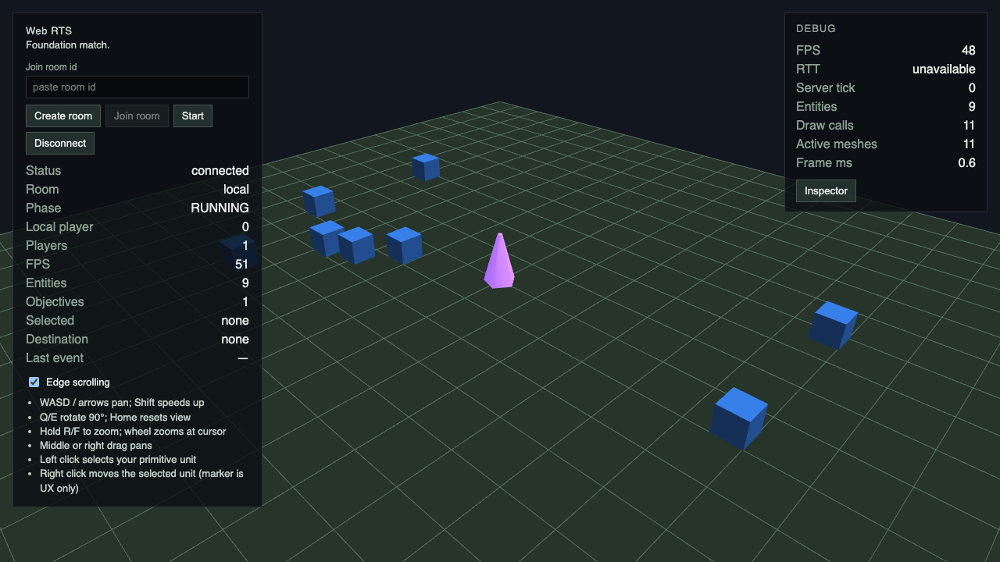
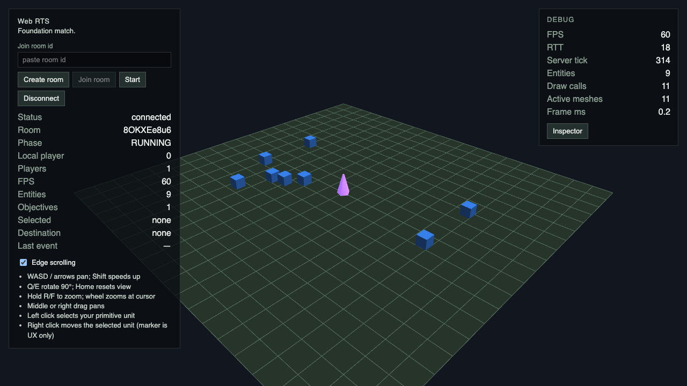

### Четыре ракурса

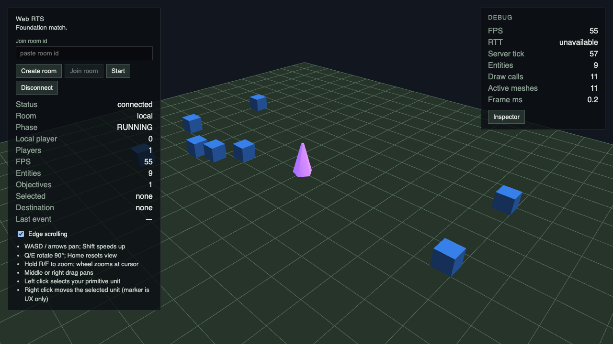
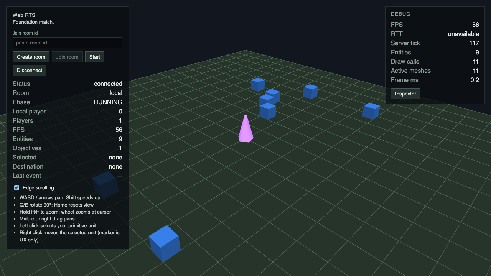
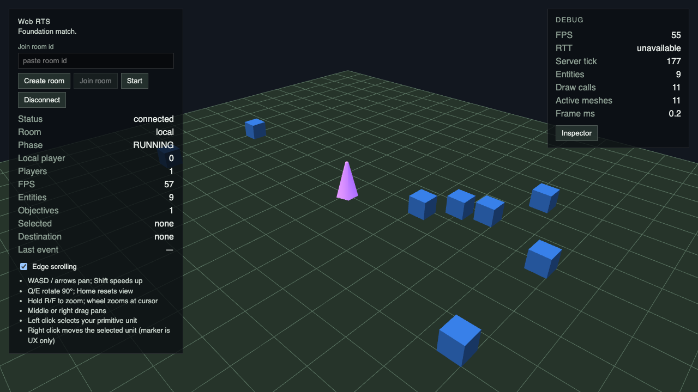
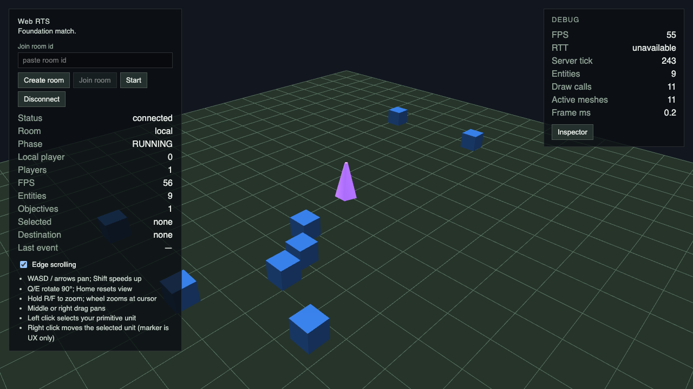

### Edge, drag, MOVE и cursor zoom

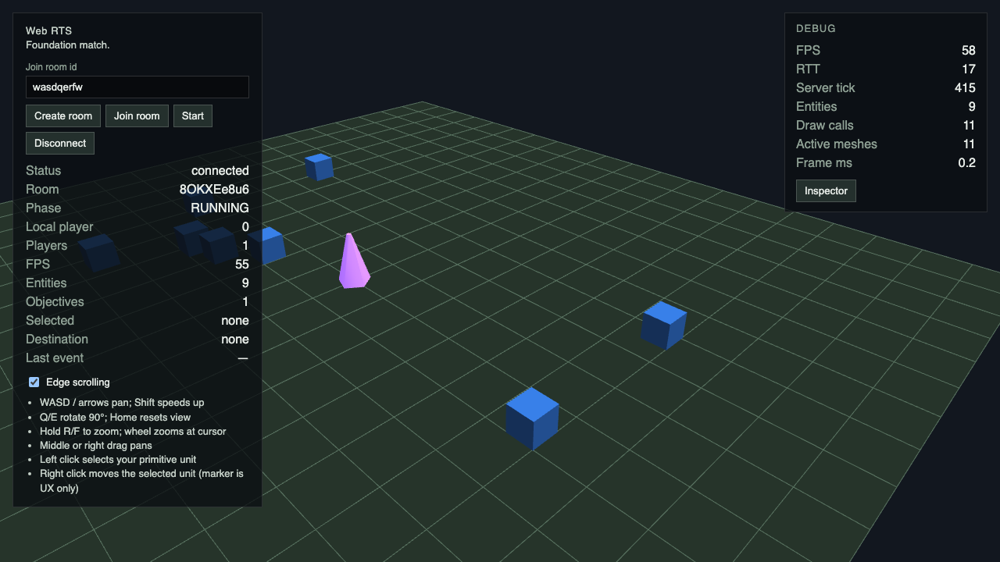
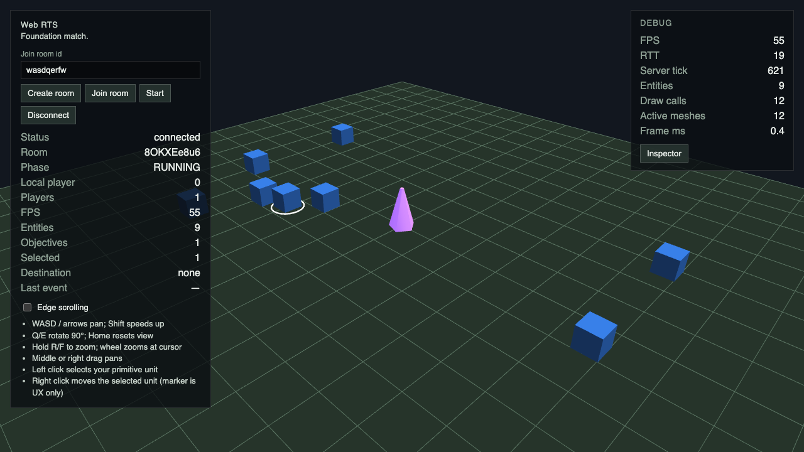
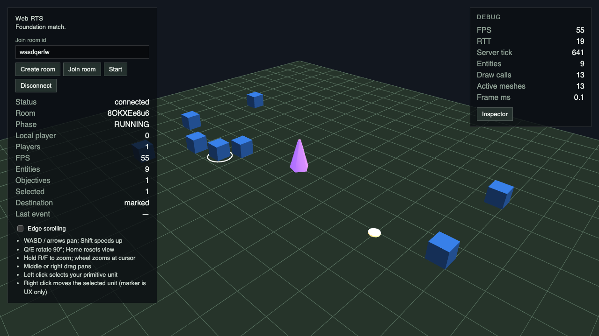
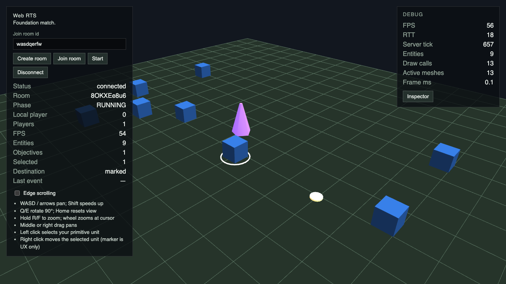

### Независимые Remote камеры — внутренний браузер

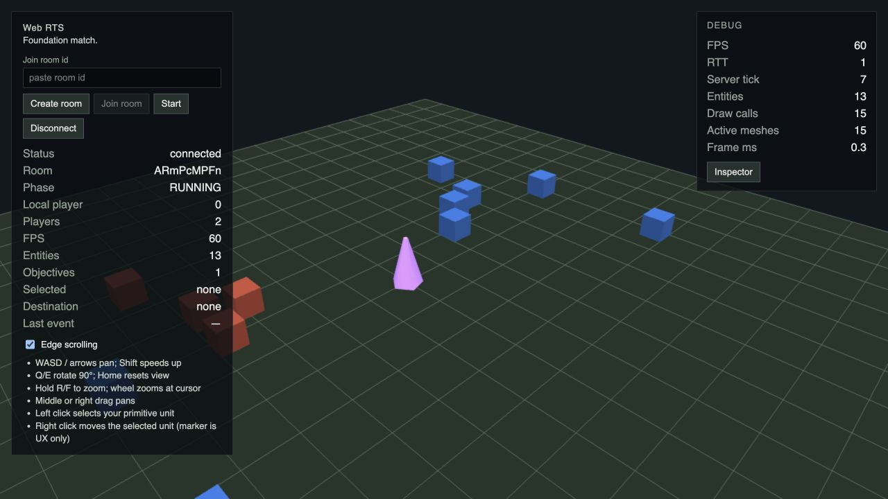
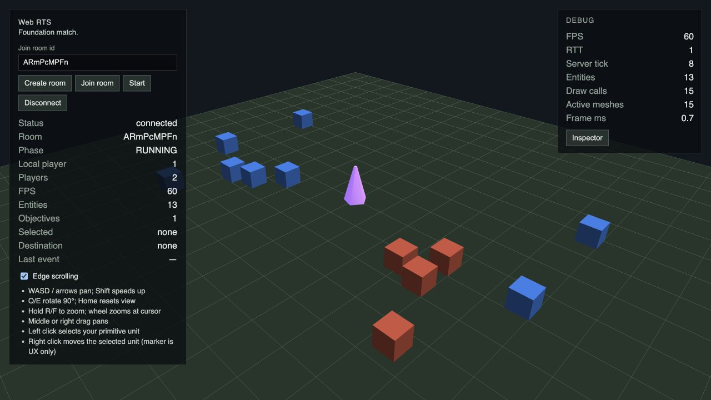

## Границы проверки

Это camera/input stage, не финальный art target G13. При strategic zoom карта физически меньше перспективного footprint: виден фон вне terrain, target остаётся в bounded navigation range. Cursor anchor уступает map bounds. Математика перехода к полному containment проверена unit regression; никаких simulation, server или protocol изменений нет.
