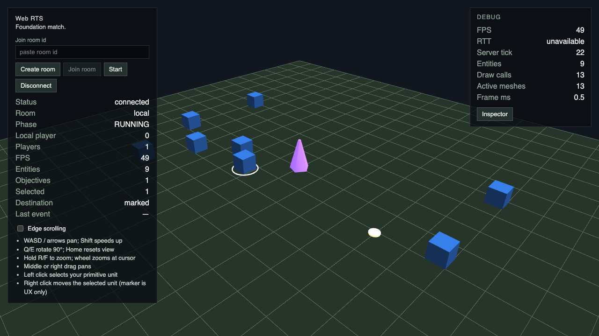
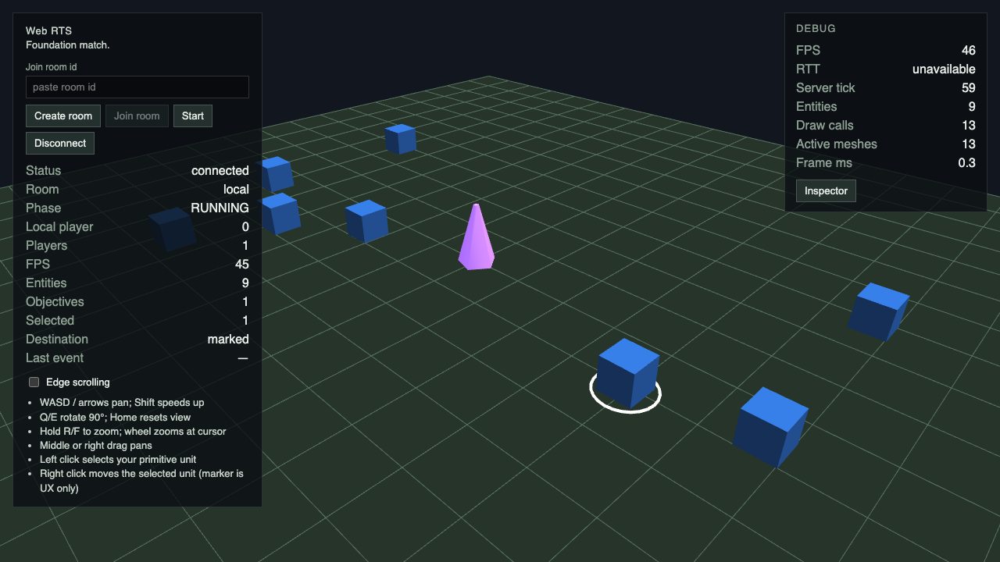
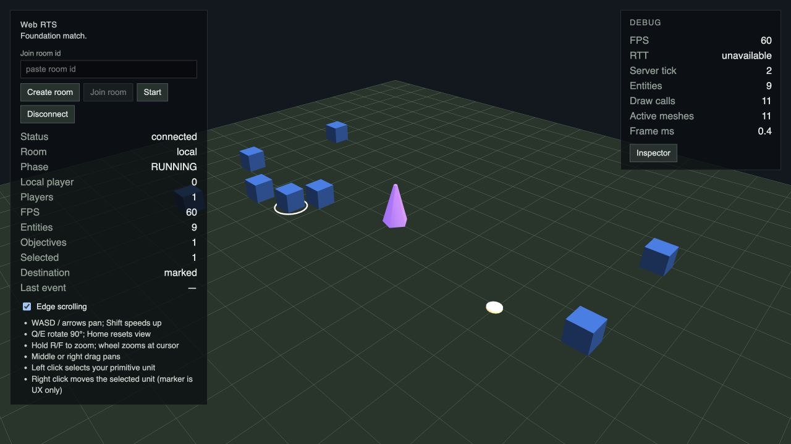
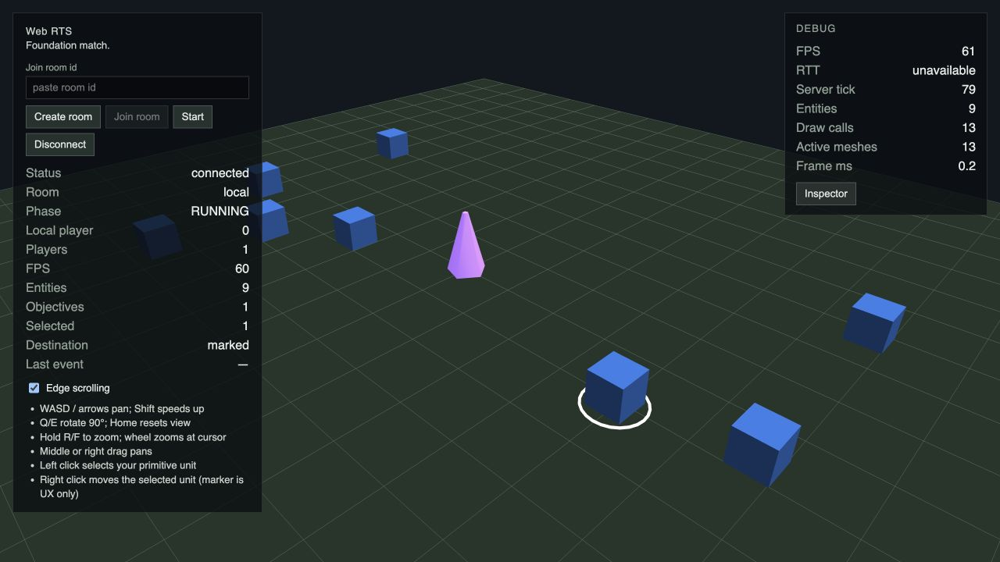
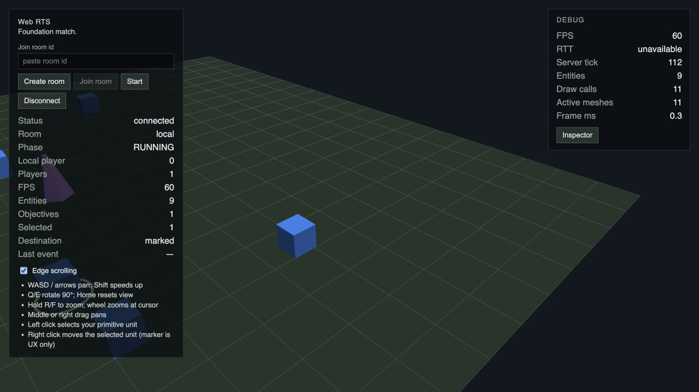
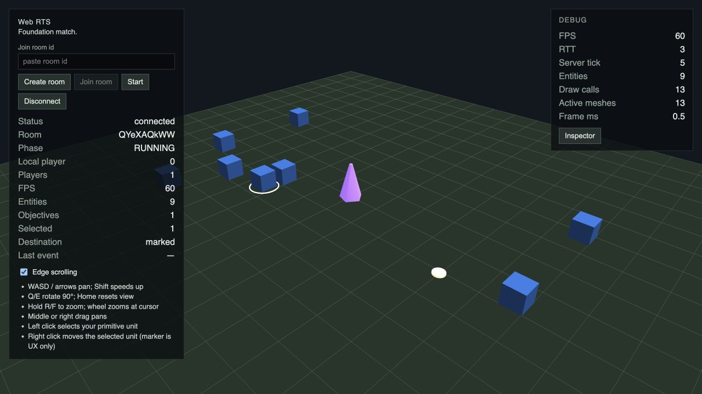
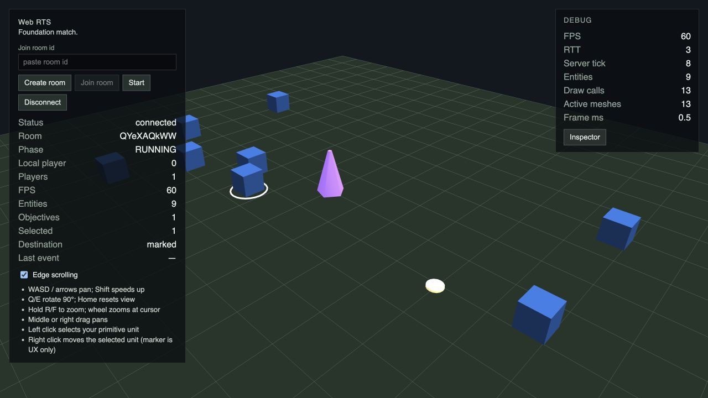
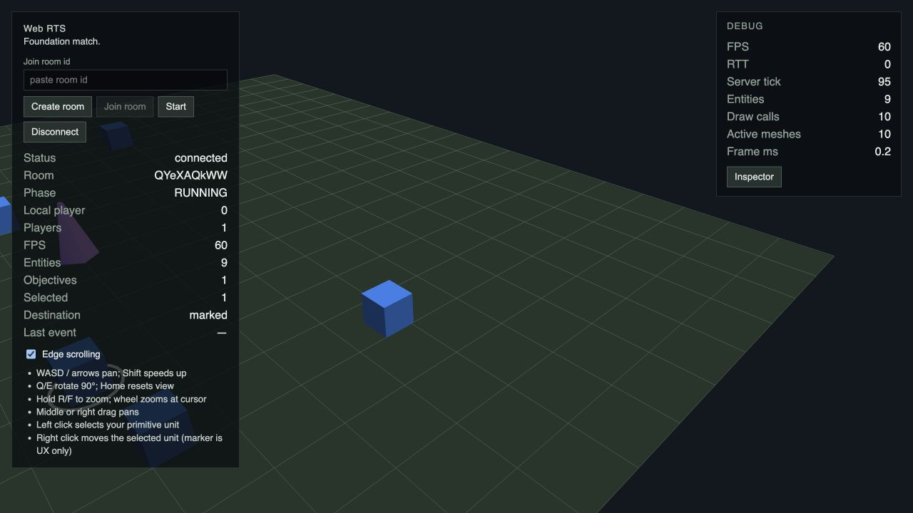

# C2 / #112 — cursor-anchored zoom

## Установленная причина

Production camera math не изменена. Ошибка находится в `markerCentroid()` старого browser oracle: фильтр `R > 230, G > 220, B > 160` в clip 100×100 захватывает и destination cylinder, и белое selection ring движущегося юнита. Юнит приходит в destination, закрывает цилиндр; видимая нижняя дуга кольца имеет другой центроид. Screenshot/readback задержки меняют степень перекрытия. Комментарий старого helper об исключении кольца не соответствует фактическому фильтру.

[Исходный main run](https://github.com/Web-Usov/web-rts/actions/runs/38431723021): Local 7,428/6,488 px, Remote 8,030/6,993 px. [Run PR #111](https://github.com/Web-Usov/web-rts/actions/runs/38434808783): Local 6,618/8,091 px, Remote 7,553 px и успешный retry. Это измерения старого цветового центроида, а не фиксированной точки земли.

Локальная последовательная проверка исходного C1 на base `bb12e6982998e7939eecf7356aef910047b1b644` дала 0,379 px в обоих режимах: быстрый renderer успевал прочитать ещё не закрытый цилиндр. Контролируемый диагностический сценарий с задержкой 2500 ms после wheel позволяет юниту прийти в destination и детерминированно воспроизводит ложное смещение 15,593 px в Local и Remote. Отдельный Playwright reproducer с исходным helper и исходным assert `< 5` завершился двумя failures без retries. Дополнительная задержка используется только при исследовании старого oracle; в исправленном тесте сохранены 650 ms settling.

Диагностика: физический RMB в (800,500), screenshot старого centroids, wheel −220 в centroid, Babylon forward ray/ground intersection и `Vector3.Project()` той же фиксированной точки до/после. Снимки и исходные числа находятся в `diagnostics.json`, `local-before.png`, `local-after.png`, `remote-before.png`, `remote-after.png`.

| Величина | Local | Remote |
| --- | --- | --- |
| Старый centroid до | (800,215; 497,668), 386 pixels | тот же |
| Старый centroid после прихода юнита | (799,495; 513,244), 487 pixels | тот же |
| Ложное смещение | 15,593 CSS px | 15,593 CSS px |
| Разница ground ray hit в фактическом integer cursor (800,497) | 0,000011 world units | 0,000019 world units |
| Проекция первоначального ground MOVE point | (800,000; 500,000) → (800,001; 500,738) | та же |
| CSS / render / DPR | 1280×720 / 1280×720 / 1 | те же |
| Radius | 28 → 22,5 | тот же |

Небольшое 0,738 px смещение первоначального MOVE point отличается от anchor drift: wheel выполнялся в centroid при y≈497, а исходный ground click был при y=500. Цветовой центр приподнятого цилиндра не является ground point. На исследованной pose boundCamera не вмешивается: target после zoom (1,550; −0,407) остаётся внутри центрального pan interval [−10,10]. Сглаживание сохраняет ray hit. При beta=π/3 и fov=0,8 все четыре viewport corner rays направлены вперёд к земле: максимальный up=tan(0,4) меньше cot(beta), знаменатель положительный. Пересечения позади камеры/горизонта в этом flow нет.

## Исправление и регрессии

E2E устанавливает единственный magenta cross на y=0 через независимый Babylon forward ray. Это test-only scene fixture, без production hooks и доступа к simulation/transport. Unlit материал и depth bias исключают shading и z-fighting. Mesh не pickable. После размещения cross не двигается и не пересоздаётся в ходе zoom.

Oracle читает реальные screenshot pixels, определяет центр симметричного ground reference, переводит screenshot coordinates в CSS coordinates и проверяет видимость/отсутствие обрезки. Фиксированного clip вокруг старого destination нет. Допуск уменьшен с 5 до 2 CSS px. Физический pan служит negative control: oracle обязан увидеть реальное перемещение больше 10 px.

Сохранены все C1 physical keyboard/edge/drag/focus/selection/MOVE проверки. Добавлены:

- Local/Remote interior wheel и constrained zoom на pan limit, затем проверка стабильности;
- отдельный Local/Remote browser flow: четыре yaw, четыре чередующихся wheel события, отсутствие накопленного drift и jitter, negative control;
- pure controller: каждый кадр zoom, восемь циклов при 30/60/144 FPS, четыре yaw, настоящий map extent; bounds имеют приоритет и settle;
- NullEngine: независимые Babylon ray/projection, четыре yaw, render scale 1/2, множество кадров сглаживания и повторных wheel событий.

Camera policy C1, gameplay, Simulation Core, Colyseus, GameTransport и protocol не изменены. Retries, CI gate, thresholds прежних C1 assertions и timeout не увеличены. C2 screenshots сохраняются в `VERIFICATION_DIR` для GitHub Actions, локально — в ignored `.artifacts/verification/c2-112`.

## Настоящий browser playtest

Инструмент: Codex In-app Browser / `cua_repl`, отдельные Local и Remote вкладки. Процессы запущены из task worktree, web 4175 / server 2569. Проверены Create room → Start, left selection, короткий RMB MOVE, wheel у внутренней точки, Home, длительный D до границы и wheel у границы. Видны увеличение сцены вокруг ground cursor, работа MOVE и ограничение pan. В обеих вкладках `dev.logs` для warn/error пусты. Визуальные test fixtures в IAB не добавлялись.

## Проверки

Верификация: `pnpm lint`, `pnpm typecheck`, `pnpm test`, `pnpm build`; затем три отдельные команды `pnpm exec playwright test tests/e2e/camera-controls.spec.ts --workers=1 --retries=0` и полный `pnpm test:e2e`. Фактические результаты финальных прогонов и GitHub Actions фиксируются в описании PR.

Исследовательские прогоны не засчитываются как final verification. Параллельные исходный/диагностический Playwright процессы столкнулись на временных trace files, а один первый исправленный прогон был перезагружен Vite при параллельном build (подтверждено trace). Финальная верификация запускается последовательно без изменения/build файлов во время browser run.

Architectural impact: **none**.

**Project Status Check: Not required** — исправлен oracle уже принятого C1, новые gameplay stages, roadmap и project-wide contracts не добавлены.
